```mermaid
flowchart TD
    subgraph BR ["BẢNG TIẾN ĐỘ AUTONOMOUS BATCH ROLLOUT — 7/7 CHUYÊN KHẢO UNBOUNDED DEPTH (93 TRANG IN)"]
        M1["<b>Mục 2.1: Hiện tượng cuốn hạt dẫn</b><br/>(20 trang &bull; 1,83 MB &bull; Chuyen_Khao_Ban_Dan_Muc_2.1.pdf)<br/>&bull; 5 MPT &bull; 12 ảnh gốc &bull; 3 bài tập giải tích HUST"]
        M2["<b>Mục 2.2: Khuếch tán hạt dẫn</b><br/>(13 trang &bull; 1,58 MB &bull; Chuyen_Khao_Ban_Dan_Muc_2.2.pdf)<br/>&bull; 4 MPT &bull; 3 ảnh gốc &bull; Dẫn xuất Einstein & Quasi-Fermi"]
        M3["<b>Mục 2.3: Các quá trình phát sinh và tái hợp</b><br/>(14 trang &bull; 961 KB &bull; Chuyen_Khao_Ban_Dan_Muc_2.3.pdf)<br/>&bull; 4 MPT &bull; 4 ảnh gốc &bull; Động học SRH & Auger"]
        M4["<b>Mục 2.4: Phương trình liên tục</b><br/>(11 trang &bull; 854 KB &bull; Chuyen_Khao_Ban_Dan_Muc_2.4.pdf)<br/>&bull; 4 MPT &bull; 1 ảnh gốc &bull; Dẫn xuất vi phân & Haynes-Shockley"]
        M5["<b>Mục 2.5: Quá trình phát xạ ion nhiệt</b><br/>(11 trang &bull; 741 KB &bull; Chuyen_Khao_Ban_Dan_Muc_2.5.pdf)<br/>&bull; 4 MPT &bull; Rào thế Schottky & Bethe & Lực ảnh"]
        M6["<b>Mục 2.6: Quá trình chui hầm (Tunneling)</b><br/>(12 trang &bull; 669 KB &bull; Chuyen_Khao_Ban_Dan_Muc_2.6.pdf)<br/>&bull; 4 MPT &bull; WKB & Đi-ốt Esaki NDR & Tiếp xúc Ohmic FE"]
        M7["<b>Mục 2.7: Các hiệu ứng trường cao</b><br/>(12 trang &bull; 763 KB &bull; Chuyen_Khao_Ban_Dan_Muc_2.7.pdf)<br/>&bull; 4 MPT &bull; Bão hòa vsat & Gunn GaAs & Đánh thủng thác lũ & HCI"]
    end

    M1 --> M2 --> M3 --> M4 --> M5 --> M6 --> M7
```

# BÁO CÁO TOÀN TRÌNH PHA 2 (AUTONOMOUS BATCH ROLLOUT) CHƯƠNG 2: CÁC HIỆN TƯỢNG VẬN CHUYỂN TRONG BÁN DẪN
## Đóng Gói Hoàn Tất 7/7 Chuyên Khảo PDF Chuẩn HUST — Kiểm Toán Lộ Trình P·A·R·T·S & Unbounded Depth

> **Học phần:** PH3190 — Vật lý & Linh kiện Bán dẫn, Viện Vật lý Kỹ thuật, Trường Đại học Bách khoa Hà Nội (HUST).  
> **Chủ thể nghiên cứu:** Bùi Trung Dũng (Sinh viên năm 3 — Khoa Vật lý Kỹ thuật).  
> **Vị thế hợp tác:** Antigravity Native Engine kiêm Cộng sự Lab biên soạn ngang hàng (*Peer-level Lab Partner*).  
> **Hệ quy chiếu tối cao:** [AGENTS.md](file:///d:/antigravity/academic-research-engine/.agents/rules/AGENTS.md) — 6 Mệnh lệnh Cốt lõi (Mệnh lệnh 2: Zero-Omission & Mệnh lệnh 4: Unbounded Depth $\ge 10\text{–}20$ trang/chuyên khảo).

---

---

# I. BẢNG TỔNG KẾT XUẤT BẢN CHUYÊN KHẢO PDF (BAI_GIANG_DONG_GOI)

Toàn bộ 7 chuyên khảo PDF đã được biên soạn và xuất bản trực tiếp bằng ReportLab theo quy chuẩn Typography DejaVu, tích hợp công thức LaTeX Mathtext $\ge 300\text{ DPI}$, đánh số trang hai lượt `Trang X / Y`, bookmarks 3 cấp, vượt qua chốt chặn tiền kiểm định linter `assert_monograph_compliance` và đồng bộ nguyên tử vào thư mục:  
`G:\My Drive\NotebookLM - Academic Knowledge Base\Vật lý và linh kiện bán dẫn\Bai_Giang_Dong_Goi\`

| STT | Phân mục | Tên tệp PDF đóng gói | Số trang | Dung lượng | Tệp ảnh gốc `[Goc]` & Mô phỏng `[Mo_Phong]` | Điểm nổi bật & Bài tập giải tích | Trạng thái |
| :---: | :---: | :--- | :---: | :---: | :--- | :--- | :---: |
| 1 | **Mục 2.1** | `Chuyen_Khao_Ban_Dan_Muc_2.1.pdf` | **20** | $1{,}83\text{ MB}$ | 12 ảnh gốc (`H. 2.1` $\to$ `2.12`) `[Mo_Phong]_Do_linh_dong_Si_GaAs` | 5 MPT, bóc tách toàn văn 3 bài toán thí dụ HUST (Slide 7, 11–12, 14), hiệu ứng Hall 3D | **PASS 100%** |
| 2 | **Mục 2.2** | `Chuyen_Khao_Ban_Dan_Muc_2.2.pdf` | **13** | $1{,}58\text{ MB}$ | 3 ảnh gốc (`H. 2.13, 2.14, 2.15`) `[Mo_Phong]_He_thuc_Einstein` | 4 MPT, dẫn xuất Fick, phân bố nhiệt, hệ thức Einstein và thế Quasi-Fermi | **PASS 100%** |
| 3 | **Mục 2.3** | `Chuyen_Khao_Ban_Dan_Muc_2.3.pdf` | **14** | $961\text{ KB}$ | 4 ảnh gốc (`H. 2.16` $\to$ `2.19`) `[Mo_Phong]_Toc_do_tai_hop_SRH` | 4 MPT, cân bằng chi tiết, bẫy sâu SRH cực đại tại $E_i$, tái hợp bề mặt $s$, và tái hợp Auger ba hạt | **PASS 100%** |
| 4 | **Mục 2.4** | `Chuyen_Khao_Ban_Dan_Muc_2.4.pdf` | **11** | $854\text{ KB}$ | 1 ảnh gốc (`H. 2.20`) `[Mo_Phong]_Xung_Haynes_Shockley` | 4 MPT, dẫn xuất vi phân phương trình liên tục $A\cdot\mathrm{d}x$, chiều dài khuếch tán $L_p$, bài toán Haynes-Shockley | **PASS 100%** |
| 5 | **Mục 2.5** | `Chuyen_Khao_Ban_Dan_Muc_2.5.pdf` | **11** | $741\text{ KB}$ | `[Mo_Phong]_Phat_xa_ion_nhiet_Richardson` | 4 MPT, mô hình phát xạ Bethe, phương trình Richardson-Dushman, và lực ảnh điện tích hạ rào $\Delta\phi_B$ | **PASS 100%** |
| 6 | **Mục 2.6** | `Chuyen_Khao_Ban_Dan_Muc_2.6.pdf` | **12** | $669\text{ KB}$ | `[Mo_Phong]_Xuyen_ham_luong_tu_WKB` | 4 MPT, xuyên ngầm WKB, đánh thủng Zener $E > 10^6\text{ V/cm}$, đi-ốt Esaki NDR, và tiếp xúc Ohmic suy biến FE | **PASS 100%** |
| 7 | **Mục 2.7** | `Chuyen_Khao_Ban_Dan_Muc_2.7.pdf` | **12** | $763\text{ KB}$ | `[Mo_Phong]_Bao_hoa_van_toc_cuon_Si_GaAs` | 4 MPT, bão hòa $v_{\text{sat}} \approx 10^7\text{ cm/s}$, hiệu ứng Gunn GaAs chuyển thung lũng $\Gamma \to L$, đánh thủng thác lũ APD và bẫy hạt nóng HCI | **PASS 100%** |
| **Tổng** | **Chương 2** | **7 Chuyên khảo PDF** | **93** | **7,23 MB** | **20 ảnh gốc + 7 đồ thị mô phỏng** | **Chuẩn mực Unbounded Depth & Zero-Omission** | **PASS 100%** |

---

# II. DANH MỤC ĐỒ THỊ MÔ PHỎNG GIẢI TÍCH MATLAB R2014b+

Đã tạo và lưu trữ toàn vẹn 7 đồ thị mô phỏng kỹ thuật đạt chuẩn **Triple Buffer Envelope** ($\delta_{\text{geom}} \ge 8\%$, $\delta_{\text{box}} \ge 6\text{ pt}$, $\delta_{\text{spine}} \ge 5\%$, độ phân giải $300\text{ DPI}$, dung lượng $\le 200\text{ KB}$) tại [Kho_Hinh_Anh](file:///G:/My%20Drive/NotebookLM%20-%20Academic%20Knowledge%20Base/V%E1%BA%ADt%20l%C3%BD%20v%C3%A0%20linh%20ki%E1%BB%87n%20b%C3%A1n%20d%E1%BA%ABn/Kho_Hinh_Anh):

1. `[Mo_Phong]_Do_linh_dong_Si_GaAs_theo_T.png` ($170{,}8\text{ KB}$): Đỉnh chuyển tiếp tán xạ tạp chất ion hóa ($\propto T^{3/2}$) và phonon mạng ($\propto T^{-3/2}$).
2. `[Mo_Phong]_He_thuc_Einstein_theo_T.png` ($167{,}1\text{ KB}$): Tỷ số Einstein $D_n/\mu_n = k_B T / q$ và nhiệt thế $V_t = 25{,}85\text{ mV}$ tại $300\text{ K}$.
3. `[Mo_Phong]_Toc_do_tai_hop_SRH_theo_Et.png` ($152{,}1\text{ KB}$): Chứng minh tốc độ tái hợp SRH đạt cực đại khi mức bẫy nằm chính giữa vùng cấm ($E_t = E_i$).
4. `[Mo_Phong]_Xung_Haynes_Shockley_theo_thoi_gian.png` ($187{,}8\text{ KB}$): Quá trình trôi dạt định hướng và khuếch tán giãn rộng của xung lỗ trống theo thời gian.
5. `[Mo_Phong]_Phat_xa_ion_nhiet_Richardson.png` ($177{,}1\text{ KB}$): Mật độ dòng phát xạ nhiệt Richardson qua rào thế Schottky ở các mức rào $\phi_B = 0{,}6; 0{,}7; 0{,}8\text{ eV}$.
6. `[Mo_Phong]_Xuyen_ham_luong_tu_WKB.png` ($196{,}0\text{ KB}$): Xác suất chui hầm lượng tử WKB giảm hàm mũ theo bề dày rào thế từ $1\text{ nm}$ đến $10\text{ nm}$.
7. `[Mo_Phong]_Bao_hoa_van_toc_cuon_Si_GaAs.png` ($183{,}6\text{ KB}$): Đối chiếu đặc tuyến bão hòa đơn điệu của Si với hiệu ứng chuyển electron thung lũng phụ gây điện trở vi phân âm trong GaAs (Gunn Effect).

---

# III. NGUYÊN NHÂN GỐC RỄ & CƠ CHẾ SỬA LỖI ĐỘ DÀI BÀI GIẢNG

### 1. Phân định nguyên nhân gốc rễ đợt phát hành trước bị ngắn:
- **Lỗi nén cấu trúc (Structural Collapsing):** Hệ thống ban đầu đã gộp toàn bộ 12–26 slide của mỗi phân mục vào duy nhất một Luận điểm Vi mô (MPT), dẫn đến việc chỉ tạo ra các tài liệu tóm tắt từ 3–5 trang.
- **Bỏ sót bài tập giải tích HUST:** Các slide chứa bài toán mẫu (Slide 7, 11–12, 14 của Mục 2.1) bị rút gọn thành kết quả đơn lẻ thay vì dẫn xuất toàn văn và thay số cụ thể từng bước.

### 2. Biện pháp khắc phục triệt để đã thực hiện:
- **Phân rã đa MPT theo cấu trúc sâu:** Mỗi phân mục được phân rã thành **4 đến 5 Luận điểm Vi mô (MPT)** độc lập.
- **Dẫn xuất toàn bộ chuỗi nhân quả (Causal Flowchain):** Mọi công thức đều được triển khai tường minh qua các bước biến đổi trung gian, bảng danh pháp Nomenclature chuẩn ISO 80000-2, và cơ chế tiệm cận Asymptotic Sanity Check.
- **Nâng cấp độ sâu toàn chương:** Nâng tổng số trang toàn chương từ ~25 trang lên **93 trang in chuyên khảo**, bình quân **13,3 trang/chuyên khảo**, đạt 100% tiêu chuẩn Mệnh lệnh 4 (*Unbounded Depth*).

---

# IV. QUẢN TRỊ TIẾN ĐỘ CHECKPOINT & TÍNH TOÀN VẸN

- Tệp trạng thái `PROGRESS_CHECKPOINT.json` tại thư mục mẹ học phần trên Google Drive `G:\` đã ghi nhận trạng thái `phase_2_completed_unbounded_depth` với 7/7 mục hoàn tất.
- Toàn bộ tệp tạm trong `%TEMP%` đã được cách ly sạch sẽ, không để lại bất kỳ tệp trùng lặp có hậu tố ` (1).pdf` hay rác hệ thống trên Google Drive `G:\`.
