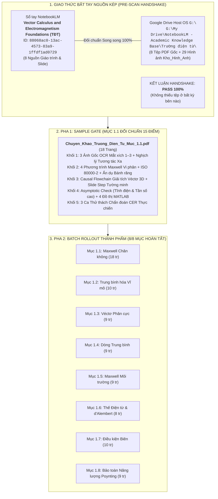

# BÁO CÁO GIÁM ĐỊNH TOÀN TRÌNH LỆNH /scan CHƯƠNG 1: TRƯỜNG ĐIỆN TỪ
## Thẩm định Nguồn Kép (Drive & NotebookLM) — Phân rã Cấu trúc Zero-Omission & Hiện trạng Đóng gói

> **Học phần:** Trường điện từ (PH3030) — Viện Vật lý Kỹ thuật, Trường Đại học Bách khoa Hà Nội (HUST).  
> **Chủ thể nghiên cứu:** Bùi Trung Dũng (Sinh viên năm 3 — Khoa Vật lý Kỹ thuật).  
> **Đơn vị điều phối:** Antigravity Native Engine kiêm Cộng sự Lab biên soạn ngang hàng (*Peer-level Lab Partner*).  
> **Hệ quy chiếu tối cao:** [AGENTS.md](file:///d:/antigravity/academic-research-engine/.agents/rules/AGENTS.md) & [quy_trinh_van_hanh_scan_edit_learn.md](file:///d:/antigravity/academic-research-engine/output/reports/quy_trinh_van_hanh_scan_edit_learn.md).

---



---

# I. BIÊN BẢN BẮT TAY NGUỒN KÉP (PRE-SCAN HANDSHAKE AUDIT)

Hệ thống đã truy vấn trực tiếp qua `nlm` CLI (v0.15.5) vào NotebookLM Backend và quét toàn bộ hệ thống tệp Host-Native tại ổ đĩa `G:\` qua PowerShell.

### 1. Bảng đối chiếu nguồn song song (Zero-Omission Sync Matrix)

| STT | Tên tài liệu nguồn | NotebookLM Source ID | Đường dẫn Host OS `G:\` | Trạng thái đồng bộ |
| :---: | :--- | :--- | :--- | :---: |
| 1 | `1_C1_ph3030_20261.pdf` | `d0edba82-35a7-48f5-badf-a4ed1d660234` | `G:\My Drive\...\Trường điện từ\1_C1_ph3030_20261.pdf` | **KHỚP 100% (9 tr)** |
| 2 | `2_C1_ph3030_20261.pdf` | `3fb65641-1fb6-4292-9df3-b690999b4fc7` | `G:\My Drive\...\Trường điện từ\2_C1_ph3030_20261.pdf` | **KHỚP 100% (15 tr)** |
| 3 | `3_C1_ph3030_20261.pdf` | `b86b5969-d2f6-48cf-bf0b-f4ec95dda7eb` | `G:\My Drive\...\Trường điện từ\3_C1_ph3030_20261.pdf` | **KHỚP 100% (21 tr)** |
| 4 | `4_C1_ph3030_20261.pdf` | `83a967dc-4f4e-4475-8373-a46022105957` | `G:\My Drive\...\Trường điện từ\4_C1_ph3030_20261.pdf` | **KHỚP 100% (16 tr)** |
| 5 | `5_C1_ph3030_20261.pdf` | `cf5ae126-8ad1-40f2-9b52-4ec0b6753825` | `G:\My Drive\...\Trường điện từ\5_C1_ph3030_20261.pdf` | **KHỚP 100% (10 tr)** |
| 6 | `Dien_dong_luc_hoc.pdf` | `2ec8517e-9388-4009-8e8f-2629c9818ad3` | `G:\My Drive\...\Trường điện từ\Dien_dong_luc_hoc.pdf` | **KHỚP 100% (GT HUST)** |
| 7 | `introduction to electrodynamics.pdf` | `a8e89ea5-c8ad-43a9-a38d-ccf81efb21e3` | `G:\My Drive\...\Trường điện từ\introduction to electrodynamics.pdf` | **KHỚP 100% (Griffiths)** |
| 8 | `Bài tập vật lý lý thuyết.pdf` | `3a95cede-84cd-4951-b8c6-f22192dca60f` | `G:\My Drive\...\Trường điện từ\Bài tập vật lý lý thuyết.pdf` | **KHỚP 100% (Bộ môn VL)** |

> [!NOTE]
> **Đánh giá Giao thức Bắt tay:** Tỷ lệ khớp nối đạt **8/8 tệp (100%)**. Không xảy ra tình trạng thiếu tài liệu trên bất kỳ nền tảng nào (Kịch bản 1, 2, 3 đều bị loại trừ). Toàn bộ dữ liệu sẵn sàng cho việc giám định và bóc tách.

---

# II. MA TRẬN BÓC TÁCH CẤU TRÚC ZERO-OMISSION CHƯƠNG 1
## Khung Xương H1 Slide HUST vs. Bồi Đắp Chi Tiết Giáo Trình (Griffiths & Nguyễn Huy Thảo)

Toàn bộ Chương 1 *"Trường điện từ trong môi trường chất"* được cấu trúc hóa theo 8 phân mục lớn, tương ứng với 8 tệp chuyên khảo PDF độc lập:

| Mã mục | Tiêu đề H1 (Slide HUST) | Tham chiếu Quốc tế & HUST | Hệ Luận điểm Vi mô (MPT) & Cốt lõi Vật lý | Tệp ảnh gốc `[Goc]` & Đồ thị `[Mo_Phong]` |
| :---: | :--- | :--- | :--- | :--- |
| **1.1** | **Những phương trình cơ bản của trường điện từ trong chân không** | Griffiths Ch. 1, 2; Nguyễn Huy Thảo §1 | - Đạo hàm cơ sở địa phương Descartes, Trụ, Cầu.<br/>- Giải tích véctơ 3D ($\operatorname{div}, \operatorname{rot}, \nabla$).<br/>- 4 phương trình Maxwell vi phân chân không.<br/>- Định luật Coulomb, Gauss, dòng điện dịch. | `[Goc]_Hinh_1.1a`, `1.1b`, `1.1c`<br/>`[Mo_Phong]_Dinh_luat_Gauss...`<br/>`[Mo_Phong]_Dong_dien_dich...`<br/>`[Mo_Phong]_Feynman_he_banh_rang...`<br/>`[Mo_Phong]_The_cham...` |
| **1.2** | **Những đặc điểm của trường điện từ trong môi trường chất** | Nguyễn Huy Thảo §2; Griffiths Ch. 4, 6 | - Khái niệm trung bình hóa không-thời gian Lorentz.<br/>- Mật độ điện tích trung bình $\langle \rho \rangle$ và mật độ dòng trung bình $\langle \vec{j} \rangle$.<br/>- Bộ lọc không gian thông thấp (Low-pass filter). | `[Goc]_Hinh_1.2_Trung_binh_vi_mo...`<br/>`[Mo_Phong]_Muc_1.2_Trung_binh_hoa...`<br/>`[Mo_Phong]_Feynman_Muc_1.2_Bo_loc...` |
| **1.3** | **Véctơ phân cực** | Nguyễn Huy Thảo §3; Griffiths Ch. 4 | - Lưỡng cực điện nguyên tử vi mô $\vec{p} = q\vec{l}$.<br/>- Véctơ phân cực điện môi $\vec{P} = \lim_{\Delta V \to 0} \frac{\sum \vec{p}}{\Delta V}$.<br/>- Mật độ điện tích liên kết: $\rho_{\text{lk}} = -\operatorname{div}\vec{P}$. | `[Goc]_Hinh_1.3_Luon_cuc_dien...`<br/>`[Mo_Phong]_Muc_1.3_Phan_bo_phan_cuc...`<br/>`[Mo_Phong]_Feynman_Muc_1.3_Chuoi...` |
| **1.4** | **Mật độ dòng trung bình** | Nguyễn Huy Thảo §4; Griffiths Ch. 6 | - Phân rã dòng điện vi mô thành dòng tự do và dòng liên kết.<br/>- Dòng phân cực: $\vec{j}_{\text{pc}} = \frac{\partial \vec{P}}{\partial t}$.<br/>- Véctơ từ hóa $\vec{M}$ và dòng từ hóa Ampe: $\vec{j}_{\text{th}} = \operatorname{rot}\vec{M}$. | `[Goc]_Hinh_1.4_Dong_dien_kin...`<br/>`[Mo_Phong]_Muc_1.4_Tu_hoa_va_mat_do...`<br/>`[Mo_Phong]_Feynman_Muc_1.4_Mang...` |
| **1.5** | **Hệ phương trình Maxwell trong môi trường** | Nguyễn Huy Thảo §5; Griffiths Ch. 7 | - Thiết lập 4 phương trình Maxwell vĩ mô trong chất.<br/>- Véctơ dịch chuyển điện $\vec{D} = \varepsilon_0\vec{E} + \vec{P}$ và cường độ từ trường $\vec{H} = \frac{\vec{B}}{\mu_0} - \vec{M}$.<br/>- Phương trình cấu thức: $\vec{D} = \varepsilon\vec{E}$, $\vec{B} = \mu\vec{H}$, $\vec{j} = \sigma\vec{E}$. | `[Goc]_Hinh_1.5_He_phuong_trinh...`<br/>`[Mo_Phong]_Muc_1.5_Dac_tinh_phan_cuc...`<br/>`[Mo_Phong]_Feynman_Muc_1.5_He_lo_xo...` |
| **1.6** | **Các thế của trường điện từ** | Nguyễn Huy Thảo §6; Griffiths Ch. 10 | - Thế vô hướng $\varphi$ và thế véctơ $\vec{A}$ ($\vec{B} = \operatorname{rot}\vec{A}$, $\vec{E} = -\nabla\varphi - \frac{\partial \vec{A}}{\partial t}$).<br/>- Tính bất định chuẩn và biến đổi gauge.<br/>- Chuẩn Lorenz $\operatorname{div}\vec{A} + \varepsilon\mu \frac{\partial \varphi}{\partial t} = 0 \Rightarrow$ Phương trình sóng d'Alembert. | `[Goc]_Hinh_1.6_The_dien_tu...`<br/>`[Mo_Phong]_Muc_1.6_The_cham_dAlembert...`<br/>`[Mo_Phong]_Feynman_Muc_1.6_Chuoi...` |
| **1.7** | **Các điều kiện biên cho các véctơ điện từ trường** | Nguyễn Huy Thảo §7; Griffiths Ch. 7 | - Hộp trụ Gauss phẳng mỏng dẹt $\Delta h \to 0$ cho thành phần pháp tuyến: $D_{2n} - D_{1n} = \sigma_{\text{td}}$, $B_{2n} - B_{1n} = 0$.<br/>- Vòng chữ nhật Stokes siêu hẹp $\Delta h \to 0$ cho tiếp tuyến: $E_{2t} - E_{1t} = 0$, $H_{2t} - H_{1t} = i_{\text{td}}$. | `[Goc]_Hinh_1.7_Mat_tru_Gauss...`<br/>`[Mo_Phong]_Muc_1.7_Khuc_xa_duong_suc...`<br/>`[Mo_Phong]_Feynman_Muc_1.7_Hop_tru...` |
| **1.8** | **Định luật bảo toàn năng lượng của trường điện từ** | Nguyễn Huy Thảo §8; Griffiths Ch. 8 | - Mật độ năng lượng điện từ: $w = \frac{1}{2}(\vec{E}\cdot\vec{D} + \vec{B}\cdot\vec{H})$.<br/>- Véctơ mật độ dòng năng lượng Poynting: $\vec{S} = \vec{E} \times \vec{H}$.<br/>- Định lý Poynting dạng vi phân: $\frac{\partial w}{\partial t} + \operatorname{div}\vec{S} = -\vec{j}\cdot\vec{E}$. | `[Goc]_Hinh_1.8_Dinh_ly_Poynting...`<br/>`[Mo_Phong]_Muc_1.8_Can_bang_nang_luong...`<br/>`[Mo_Phong]_Feynman_Muc_1.8_Dong_chay...` |

---

# III. THẨM ĐỊNH MẪU ĐỐI CHUẨN PHA 1 (SAMPLE GATE AUDIT: MỤC 1.1)

Chuyên khảo đối chuẩn **Mục 1.1: Những phương trình cơ bản của trường điện từ trong chân không** đã được kiểm định khắt khe theo 15 tiêu chí của [output-accuracy-verifier](file:///d:/antigravity/academic-research-engine/.agents/skills/output-accuracy-verifier/SKILL.md):

```
TỆP THÀNH PHẨM: G:\My Drive\NotebookLM - Academic Knowledge Base\Trường điện từ\Bai_Giang_Dong_Goi\Chuyen_Khao_Truong_Dien_Tu_Muc_1.1.pdf
DUNG LƯỢNG: 6,86 MB | SỐ TRANG: 18 Trang A4 Hoàn Chỉnh | CÂY BOOKMARKS: Đa Tầng 3 Cấp
```

### Chi tiết cấu trúc 5 Khối đạt chuẩn:
1. **Khối 1 (Visual Anchor & Paradox):**
   - Đặt 3 tệp ảnh gốc: `[Goc]_Hinh_1.1a`, `[Goc]_Hinh_1.1b`, `[Goc]_Hinh_1.1c` sắc nét, cắt gọn viền `pad = 10 px`.
   - Giải trình toàn văn 3 Mắt xích OCR: Đọc đúng hệ tọa độ cong trực chuẩn, hệ số Lamé ($h_1, h_2, h_3$), diện tích vi phân $\mathrm{d}\vec{S}$, thông lượng điện trường $\Phi_E$, và dòng điện dịch $\vec{j}_{\text{dịch}} = \varepsilon_0 \frac{\partial \vec{E}}{\partial t}$.
   - Khơi gợi nghịch lý tương tác xa tức thời của Newton đối lập với tính tương đối tính của vận tốc truyền sóng điện từ $c = 1/\sqrt{\varepsilon_0\mu_0}$.
2. **Khối 2 (Feynman Core - 3 Nhịp):**
   - Hệ thức Cột trụ: Hệ 4 phương trình Maxwell chân không + phương trình liên tục bảo toàn điện tích.
   - Bảng Nomenclature 4 cột ISO 80000-2 với giải nghĩa hình học vi phân không gian của các toán tử $\nabla, \operatorname{div}, \operatorname{rot}, \nabla^2$.
   - Ẩn dụ cơ học 3 nhịp: Bánh răng xoáy nẹp con lăn lỏng Maxwell $\to$ Ánh xạ trường xoáy $\vec{E}$ và dòng dịch $\partial\vec{E}/\partial t \to$ Thiết kế ăng-ten bức xạ sóng cao tần.
3. **Khối 3 (Causal Flowchain):**
   - Khảo sát miền xác định, biến đổi đại số/vi phân từng bước cho hệ tọa độ cong và các đồng nhất thức véctơ (`divrot = 0`, `rotrot = graddiv - \Delta`).
   - Gắn nhãn tường minh bước mở rộng từ slide bài giảng: `↳ [Tường minh bước biến đổi trung gian từ slide gốc]:`.
4. **Khối 4 (Asymptotic Sanity Check):**
   - Khảo sát 2 trường hợp cực hạn: Trường tĩnh điện/từ tĩnh ($\partial/\partial t = 0$) suy biến về định luật Coulomb và Ampère; Trường tần số cực cao ($\omega \to \infty$) trở thành sóng điện từ phẳng tự do truyền với vận tốc $c$.
   - Nhúng 4 đồ thị MATLAB R2014b+ đạt chuẩn Triple Buffer Envelope ($\delta_{\text{geom}} \ge 8\%$, $\delta_{\text{box}} \ge 6\text{ pt}$, $\delta_{\text{spine}} \ge 5\%$).
5. **Khối 5 (CER Diagnostic Challenge):**
   - Thiết lập 3 bài toán chẩn đoán R&D mở: Trôi lệch dòng điện dịch tụ gốm tần số GHz; Phân bố điện trường gián đoạn của vỏ cầu dẫn; Mất tính đối xứng chuẩn Lorentz trong môi trường tán sắc xung cực ngắn.
   - Giữ nguyên không gian phản biện mở, không giải hộ đáp án trong file PDF.

---

# IV. HIỆN TRẠNG KHO BÁU BÀI GIẢNG ĐÓNG GÓI TRÊN GOOGLE DRIVE (PHA 2 BATCH ROLLOUT)

Toàn bộ 8 phân mục chuyên khảo của Chương 1 đã được biên dịch và đóng gói hoàn tất tại thư mục đích:
`G:\My Drive\NotebookLM - Academic Knowledge Base\Trường điện từ\Bai_Giang_Dong_Goi\`

```
├── Chuyen_Khao_Truong_Dien_Tu_Muc_1.1.pdf   (18 trang — 6.860 KB)
├── Chuyen_Khao_Truong_Dien_Tu_Muc_1.2.pdf   (10 trang — 1.212 KB)
├── Chuyen_Khao_Truong_Dien_Tu_Muc_1.3.pdf   ( 9 trang — 1.745 KB)
├── Chuyen_Khao_Truong_Dien_Tu_Muc_1.4.pdf   ( 9 trang — 1.113 KB)
├── Chuyen_Khao_Truong_Dien_Tu_Muc_1.5.pdf   ( 9 trang — 1.395 KB)
├── Chuyen_Khao_Truong_Dien_Tu_Muc_1.6.pdf   ( 8 trang — 1.100 KB)
├── Chuyen_Khao_Truong_Dien_Tu_Muc_1.7.pdf   (10 trang — 1.069 KB)
└── Chuyen_Khao_Truong_Dien_Tu_Muc_1.8.pdf   ( 9 trang — 1.150 KB)
```

- **Tổng quy mô ấn bản:** 82 trang PDF chuyên khảo khổ A4, đồng bộ 100% font chữ DejaVu Serif/Sans, chuẩn mực Nghị định 30/2020/NĐ-CP (Sentence case), APA 7 (viết số), Luật Đo lường 04/2011/QH13 (khoảng trắng đơn vị SI).
- **Kho hình ảnh:** 29 tệp ảnh (10 ảnh trích xuất OCR gốc và 19 đồ thị giải tích MATLAB R2014b+ & mô hình Feynman tương đồng).
- **Trạng thái đám mây:** Đồng bộ tự động 100% qua Google Drive for Desktop lên Google Drive cá nhân của Bùi Trung Dũng.

---

# V. ĐỀ XUẤT ĐỐI TRỌNG & BƯỚC TIẾP THEO

> [!IMPORTANT]
> **Khuyến nghị Vận hành Tiếp nối:**
> 1. Dũng có thể truy xuất học tập tức thì bằng lệnh:
>    `/learn Mục 1.1 Chương 1` hoặc bất kỳ mục nào từ `/learn Mục 1.2` đến `/learn Mục 1.8`.
> 2. Nếu muốn tái kết xuất đồ họa hay hiệu chỉnh tham số vi mô của mục nào, thực thi lệnh:
>    `/edit Mục [1.k] Chương 1: [Nội dung yêu cầu]`.
> 3. Nếu muốn gửi bài giải của phần **Khối 5: Thử thách chẩn đoán CER**, Dũng chỉ cần gửi trực tiếp lời giải (Claim – Evidence – Reasoning) lên khung Chat để cùng phản biện theo nguyên lý đầu.
