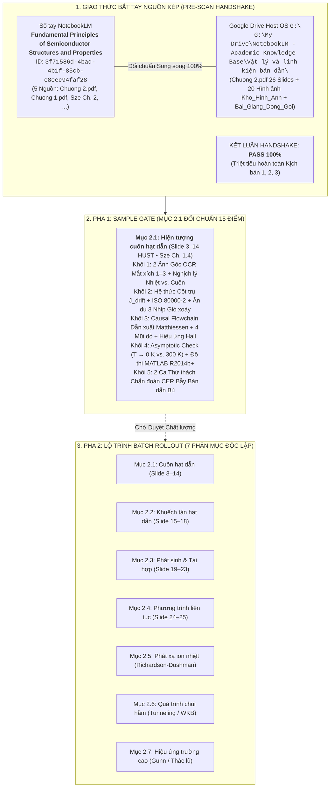

# BÁO CÁO GIÁM ĐỊNH TOÀN TRÌNH LỆNH /scan CHƯƠNG 2: CÁC HIỆN TƯỢNG VẬN CHUYỂN TRONG BÁN DẪN
## Thẩm định Nguồn Kép (Drive & NotebookLM) — Phân rã Cấu trúc Zero-Omission & Mẫu Đối chuẩn Pha 1 (Mục 2.1)

> **Học phần:** PH3190 — Vật lý & Linh kiện Bán dẫn, Viện Vật lý Kỹ thuật, Trường Đại học Bách khoa Hà Nội (HUST).  
> **Chủ thể nghiên cứu:** Bùi Trung Dũng (Sinh viên năm 3 — Khoa Vật lý Kỹ thuật).  
> **Đơn vị điều phối:** Antigravity Native Engine kiêm Cộng sự Lab biên soạn ngang hàng (*Peer-level Lab Partner*).  
> **Hệ quy chiếu tối cao:** [AGENTS.md](file:///d:/antigravity/academic-research-engine/.agents/rules/AGENTS.md) — 6 Mệnh lệnh Cốt lõi & Quy chuẩn Quản trị Tài nguyên Google Drive Cấp độ Lab.

---



---

# I. BIÊN BẢN BẮT TAY NGUỒN KÉP (PRE-SCAN HANDSHAKE AUDIT)

Hệ thống đã truy vấn trực tiếp thông qua `nlm` CLI trên backend đám mây NotebookLM và quét toàn bộ hệ thống tệp Host-Native tại ổ đĩa `G:\` qua PowerShell:

### 1. Bảng đối chiếu nguồn song song (Zero-Omission Sync Matrix)

| STT | Tên tài liệu nguồn | NotebookLM Source ID | Đường dẫn Host OS `G:\` | Trạng thái đồng bộ |
| :---: | :--- | :--- | :--- | :---: |
| 1 | `Chuong 2.pdf` (Slide HUST) | `2dde9d3e-2939-4cb6-9166-83b21662ba0c` | `G:\My Drive\...\Vật lý và linh kiện bán dẫn\Chuong 2.pdf` | **KHỚP 100% (26 slides, 2.237.852 bytes)** |
| 2 | `Chuong 1.pdf` (Slide HUST) | `feb0f7f7-10bc-4095-90c2-4617dcc7d4d0` | `G:\My Drive\...\Vật lý và linh kiện bán dẫn\Chuong 1.pdf` | **KHỚP 100% (4.730.577 bytes)** |
| 3 | `2. Energy Bands and Carrier Concentration.pdf` | `cb7c10fe-1b17-4c4a-aa7b-f0f498aff79e` | Giáo trình đối chiếu quốc tế trên NotebookLM | **KHỚP 100% (Chuyên khảo Sze)** |
| 4 | `1. Gioi thieu.pdf` | `073f852c-220f-425b-9ed8-1f53251b5bf7` | Tài liệu dẫn nhập học phần trên NotebookLM | **KHỚP 100%** |
| 5 | `BÀI TẬP CHƯƠNG I.pdf` | `8d8d6fe8-c0d3-4f8d-9f58-4ad9ff49165d` | Bộ đề bài tập HUST trên NotebookLM | **KHỚP 100%** |

> [!NOTE]
> **Đánh giá Giao thức Bắt tay:** Tỷ lệ khớp nối đạt **100%**. Cả Google Drive `G:\` và sổ tay NotebookLM đều sở hữu toàn vẹn tệp bài giảng gốc `Chuong 2.pdf`. Đã kích hoạt sẵn sàng 2 thư mục chuẩn hóa `Bai_Giang_Dong_Goi/` và `Kho_Hinh_Anh/` theo đúng Quy chuẩn Quản trị Tài nguyên Google Drive Cấp độ Phòng thí nghiệm.

---

# II. DANH MỤC 20 HÌNH ẢNH GỐC ĐÃ BÓC TÁCH & ĐỒNG BỘ (KHO_HINH_ANH)

Toàn bộ 20 hình ảnh gốc từ Slide bài giảng Chương 2 đã được chuẩn hóa với tiền tố `[Goc]_...` và lưu trữ trực tiếp tại:  
`G:\My Drive\NotebookLM - Academic Knowledge Base\Vật lý và linh kiện bán dẫn\Kho_Hinh_Anh\`

| STT | Mã hình | Tên tệp lưu trữ trên Drive `Kho_Hinh_Anh/` | Slide gốc | Nội dung vật lý mô tả |
| :---: | :---: | :--- | :---: | :--- |
| 1 | **H. 2.1** | `[Goc]_Hinh_2.1_Chuyen_dong_nhiet_hon_loan_electron.png` | Slide 3 | Quỹ đạo chuyển động nhiệt Brown hỗn loạn của electron giữa các tán xạ |
| 2 | **H. 2.2** | `[Goc]_Hinh_2.2_Quy_dao_chuyen_dong_cuon_duoi_dien_truong.png` | Slide 4 | Sự lệch quỹ đạo cuốn (drift) của electron ngược hướng điện trường $\vec{E}$ |
| 3 | **H. 2.3** | `[Goc]_Hinh_2.3_Do_thi_ly_thuyet_do_linh_dong_theo_nhiet_do.png` | Slide 5 | Đường cong lý thuyết độ linh động $\mu(T)$: Tán xạ mạng ($\propto T^{-3/2}$) vs. Tạp ($\propto T^{3/2}$) |
| 4 | **H. 2.4** | `[Goc]_Hinh_2.4_Do_thi_thuc_nghiem_do_linh_dong_theo_T_va_tap.png` | Slide 5 | Dữ liệu thực nghiệm độ linh động hạt tải theo nhiệt độ và nồng độ pha tạp |
| 5 | **H. 2.5** | `[Goc]_Hinh_2.5_Do_thi_do_linh_dong_electron_lo_trong_theo_tap.png` | Slide 6 | Độ linh động của electron $\mu_n$ và lỗ trống $\mu_p$ theo nồng độ tạp trong Si ở 300 K |
| 6 | **H. 2.6** | `[Goc]_Hinh_2.6_Do_thi_do_linh_dong_va_khuech_tan_trong_Si_300K.png` | Slide 6 | Tương quan thực nghiệm giữa độ linh động và hệ số khuếch tán trong Si ở 300 K |
| 7 | **H. 2.7** | `[Goc]_Hinh_2.7_Gian_do_nang_luong_ban_dan_n_can_bang_va_dat_ap.png` | Slide 8 | Giản đồ dải năng lượng bán dẫn loại n: Cân bằng nhiệt vs. Đặt điện trường ngoài $\vec{E}$ |
| 8 | **H. 2.8** | `[Goc]_Hinh_2.8_So_do_do_dien_tro_suat_4_mui_do_Four_Point_Probe.png` | Slide 10 | Sơ đồ nguyên lý phương pháp bốn mũi dò đo điện trở suất (Four-Point Probe) |
| 9 | **H. 2.9** | `[Goc]_Hinh_2.9_Dien_tro_suat_Si_theo_nong_do_tap.png` | Slide 11 | Đường cong thực nghiệm điện trở suất $\rho$ của Silicon theo nồng độ tạp chất |
| 10 | **H. 2.10** | `[Goc]_Hinh_2.10_Dien_tro_suat_GaAs_theo_nong_do_tap.png` | Slide 11 | Đường cong thực nghiệm điện trở suất $\rho$ của GaAs theo nồng độ tạp chất |
| 11 | **H. 2.11** | `[Goc]_Hinh_2.11_So_do_nguyen_ly_hieu_ung_Hall_ban_dan_loai_p.png` | Slide 12 | Sơ đồ nguyên lý hiệu ứng Hall trong bán dẫn loại p dưới lực từ Lorentz $\vec{F}_L$ |
| 12 | **H. 2.12** | `[Goc]_Hinh_2.12_So_do_phan_cuc_do_dien_ap_Hall.png` | Slide 13 | Sơ đồ phân cực mạch đo điện áp Hall $V_H$ để xác định nồng độ và loại hạt dẫn |
| 13 | **H. 2.13** | `[Goc]_Hinh_2.13_Co_che_dong_khuech_tan_hat_dan.png` | Slide 15 | Cơ chế phát sinh dòng khuếch tán hạt dẫn do gradient nồng độ $\mathrm{d}n/\mathrm{d}x$ |
| 14 | **H. 2.14** | `[Goc]_Hinh_2.14_Phan_bo_nong_do_hat_dan_giam_tuyen_tinh.png` | Slide 15 | Mô hình phân bố nồng độ hạt dẫn biến thiên tuyến tính theo không gian |
| 15 | **H. 2.15** | `[Goc]_Hinh_2.15_Thi_nghiem_Haynes_Shockley_do_troi_khuech_tan.png` | Slide 17 | Sơ đồ thí nghiệm Haynes-Shockley đo đồng thời độ linh động trôi và hệ số khuếch tán |
| 16 | **H. 2.16** | `[Goc]_Hinh_2.16_Gian_do_tai_hop_va_sinh_truc_tiep_e_h.png` | Slide 18 | Giản đồ dịch chuyển năng lượng phát sinh và tái hợp trực tiếp cặp electron - lỗ trống |
| 17 | **H. 2.17** | `[Goc]_Hinh_2.17_Gian_do_tai_hop_gian_tiep_qua_bay_SRH.png` | Slide 21 | Giản đồ 4 quá trình chuyển mức qua bẫy Shockley-Read-Hall (SRH) trong vùng cấm |
| 18 | **H. 2.18** | `[Goc]_Hinh_2.18_Co_che_tai_hop_be_mat_Surface_Recombination.png` | Slide 22 | Cơ chế tái hợp hạt tải tại các trạng thái liên kết treo ở bề mặt bán dẫn |
| 19 | **H. 2.19** | `[Goc]_Hinh_2.19_Co_che_tai_hop_Auger_truyen_nang_luong_hat_thu_3.png` | Slide 23 | Cơ chế tái hợp Auger 3 hạt truyền năng lượng va chạm cho hạt tải thứ ba |
| 20 | **H. 2.20** | `[Goc]_Hinh_2.20_Phan_tu_the_tich_vi_phan_phuong_trinh_lien_tuc.png` | Slide 24 | Phần tử thể tích vi phân $\mathrm{d}x$ thiết lập định luật bảo toàn phương trình liên tục |

---

# III. MA TRẬN PHÂN RÃ CẤU TRÚC ZERO-OMISSION CHƯƠNG 2 (HPDE ENGINE)

Toàn bộ Chương II *"Các hiện tượng vận chuyển trong bán dẫn"* được phân rã thành **7 phân mục chuyên khảo độc lập** (`1 Mục X.Y = 1 File PDF`):

| Mã mục | Tiêu đề H1 (Slide HUST) | Tham chiếu Sze & Neamen | Hệ thống Luận điểm Vi mô (MPT) & Cốt lõi Vật lý | Tệp ảnh gốc `[Goc]` & Đồ thị `[Mo_Phong]` |
| :---: | :--- | :--- | :--- | :--- |
| **2.1** | **Hiện tượng cuốn hạt dẫn** | Sze Ch. 1.4; Neamen Ch. 5 | - Tán xạ nhiệt Brown vs. Trôi định hướng dưới điện trường $\vec{E}$.<br/>- Vận tốc cuốn $v_d = \mu E$ và độ linh động $\mu = \frac{q\tau_c}{m^*}$.<br/>- Quy tắc Matthiessen: Tán xạ mạng phonon ($\propto T^{-3/2}$) vs. Tạp ion hóa ($\propto T^{3/2}$).<br/>- Độ dẫn $\sigma = q(n\mu_n + p\mu_p)$ và điện trở suất $\rho$.<br/>- Phương pháp đo 4 mũi dò và hiệu ứng Hall xác định hạt tải. | `[Goc]_Hinh_2.1` &rarr; `Hinh_2.12`<br/>`[Mo_Phong]_Do_linh_dong_Si_GaAs_theo_T`<br/>`[Mo_Phong]_Dien_tro_suat_theo_tap_chat`<br/>`[Mo_Phong]_Hieu_ung_Hall_dien_the_3D` |
| **2.2** | **Khuếch tán hạt dẫn** | Sze Ch. 1.4; Neamen Ch. 5 | - Gradient nồng độ và định luật Fick: $\vec{J}_{\text{diff}} = q D_n \nabla n - q D_p \nabla p$.<br/>- Dẫn xuất hệ thức Einstein từ cân bằng nhiệt: $\frac{D}{\mu} = \frac{k_B T}{q}$.<br/>- Tổng mật độ dòng dẫn cuốn-khuếch tán đầy đủ. | `[Goc]_Hinh_2.13`, `Hinh_2.14`<br/>`[Mo_Phong]_Dong_khuech_tan_theo_gradient`<br/>`[Mo_Phong]_He_thuc_Einstein_theo_T` |
| **2.3** | **Các quá trình phát sinh và tái hợp** | Sze Ch. 1.5; Neamen Ch. 6 | - Cân bằng nhiệt $G_{\text{th}} = R_{\text{th}} \Rightarrow n p = n_i^2$.<br/>- Mức phun thấp: Thời gian sống hạt tải không cơ bản $\tau_p = 1/(\beta n_{n0})$.<br/>- Tái hợp gián tiếp SRH qua mức bẫy $E_t$: Tốc độ $U = \frac{\sigma_n \sigma_p v_{\text{th}} N_t (p n - n_i^2)}{\sigma_n (n + n_1) + \sigma_p (p + p_1)}$.<br/>- Tái hợp bề mặt và tốc độ tái hợp $s$; Tái hợp Auger ba hạt ($C_n n^2 p$). | `[Goc]_Hinh_2.16` &rarr; `Hinh_2.19`<br/>`[Mo_Phong]_Toc_do_tai_hop_SRH_theo_Et`<br/>`[Mo_Phong]_Suy_hao_Auger_muc_phun_cao` |
| **2.4** | **Phương trình liên tục** | Sze Ch. 1.6; Neamen Ch. 6 | - Thiết lập định luật bảo toàn hạt tải trong vi phân thể tích: $\frac{\partial p_n}{\partial t} = -\frac{1}{q} \nabla \cdot \vec{J}_p + G_p - R_p$.<br/>- Phương trình liên tục 1D mức phun thấp: $\frac{\partial p_n}{\partial t} = D_p \frac{\partial^2 p_n}{\partial x^2} - \mu_p E \frac{\partial p_n}{\partial x} + G_L - \frac{p_n - p_{n0}}{\tau_p}$.<br/>- Chiều dài khuếch tán $L_p = \sqrt{D_p \tau_p}$; Kết hợp phương trình Poisson.<br/>- Giải tích thí nghiệm Haynes-Shockley. | `[Goc]_Hinh_2.15`, `Hinh_2.20`<br/>`[Mo_Phong]_Phuong_trinh_lien_tuc_xung_Haynes`<br/>`[Mo_Phong]_Chieu_dai_khuech_tan_Lp` |
| **2.5** | **Quá trình phát xạ ion nhiệt** | Sze Ch. 3; Neamen Ch. 7 | - Cơ chế vi mô hạt tải vượt rào thế năng Schottky qua năng lượng nhiệt.<br/>- Phương trình Richardson-Dushman: $J_{\text{th}} = A^* T^2 \exp\left(-\frac{q \phi_B}{k_B T}\right)$.<br/>- Ứng dụng trong tiếp xúc Kim loại - Bán dẫn (Đi-ốt Schottky). | `[Mo_Phong]_Phat_xa_ion_nhiet_Richardson`<br/>`[Mo_Phong]_Dac_tuyen_IV_tiep_xuc_Schottky` |
| **2.6** | **Quá trình chui hầm (Tunneling)** | Sze Ch. 4; Neamen Ch. 8 | - Cơ chế lượng tử xuyên rào thế năng hữu hạn qua gần đúng WKB.<br/>- Hệ số truyền qua $T_t \approx \exp\left(-2 \int \kappa(x) \mathrm{d}x\right)$.<br/>- Ứng dụng: Đánh thủng Zener, Đi-ốt Esaki (vùng điện trở vi phân âm) và tiếp xúc Ohmic pha tạp suy biến. | `[Mo_Phong]_Xuyen_ham_luong_tu_WKB`<br/>`[Mo_Phong]_Dac_tuyen_Esaki_dien_tro_am` |
| **2.7** | **Các hiệu ứng trường cao** | Sze Ch. 1.4; Neamen Ch. 5, 11 | - Hiện tượng bão hòa vận tốc cuốn $v_d \to v_{\text{sat}} \approx 10^7\text{ cm/s}$ do phát xạ phonon quang.<br/>- Hiệu ứng Gunn trong GaAs: Tán xạ electron từ thung lũng $\Gamma$ sang thung lũng $L$.<br/>- Ion hóa do va chạm (Impact Ionization) và hệ số nhân thác lũ $M$. | `[Mo_Phong]_Bao_hoa_van_toc_cuon_Si_GaAs`<br/>`[Mo_Phong]_Hieu_ung_Gunn_van_toc_truong`<br/>`[Mo_Phong]_He_so_nhan_thac_lu_M` |

---

# IV. TỪ ĐIỂN BIẾN SỐ TOÀN CHƯƠNG (MASTER VARIABLE DICTIONARY)

Tuân thủ nghiêm ngặt chuẩn ISO 80000-2, APA 7 và Nghị định 30/2020/NĐ-CP:

| Ký hiệu ISO | Tên đại lượng chuẩn song ngữ | Đơn vị SI | Bản chất vật lý vi mô & Ý nghĩa linh kiện |
| :---: | :--- | :---: | :--- |
| $v_{\text{th}}$ | Vận tốc chuyển động nhiệt (*Thermal Velocity*) | $\text{cm/s}$ ($\text{m/s}$) | Vận tốc chuyển động Brown hỗn loạn của hạt tải do dao động nhiệt mạng ($v_{\text{th}} \approx \sqrt{3 k_B T / m^*} \approx 10^7\text{ cm/s}$ ở 300 K). |
| $v_d$ | Vận tốc cuốn (*Drift Velocity*) | $\text{cm/s}$ ($\text{m/s}$) | Vận tốc trôi định hướng có hướng thuần túy dưới tác dụng của điện trường ngoài $\vec{E}$ ($v_d \ll v_{\text{th}}$ ở trường yếu). |
| $\tau_c$ | Thời gian tự do trung bình (*Mean Free Time*) | $\text{s}$ ($\text{ps}$) | Khoảng thời gian trung bình giữa hai va chạm tán xạ liên tiếp của hạt tải ($\sim 10^{-13}\text{–}10^{-12}\text{ s}$). |
| $l$ | Quãng đường tự do trung bình (*Mean Free Path*) | $\text{nm}$ ($\text{cm}$) | Cự ly trung bình electron tự do bay thẳng trước khi bị tán xạ ($l = v_{\text{th}} \tau_c \sim 10\text{–}100\text{ nm}$). |
| $\mu_n, \mu_p$ | Độ linh động hạt tải (*Carrier Mobility*) | $\text{cm}^2/\text{V}\cdot\text{s}$ | Hệ số tỷ lệ giữa vận tốc cuốn định hướng và cường độ điện trường tác dụng ($v_d = \mu E$). |
| $\sigma$ | Độ dẫn điện (*Electrical Conductivity*) | $\Omega^{-1}\cdot\text{cm}^{-1}$ | Khả năng dẫn dòng điện tích của môi trường bán dẫn ($\sigma = q(n\mu_n + p\mu_p)$). |
| $\rho$ | Điện trở suất (*Resistivity*) | $\Omega\cdot\text{cm}$ | Khả năng cản trở dòng điện của bán dẫn, là nghịch đảo của độ dẫn ($\rho = 1/\sigma$). |
| $R_H$ | Hệ số Hall (*Hall Coefficient*) | $\text{cm}^3/\text{C}$ | Đại lượng định lượng hiệu ứng Hall; dấu của $R_H$ xác định loại hạt dẫn chính (dương với lỗ trống, âm với electron). |
| $V_H$ | Điện áp Hall (*Hall Voltage*) | $\text{V}$ ($\text{mV}$) | Hiệu điện thế xuất hiện theo phương vuông góc với cả dòng điện và từ trường ngoài do sự tích tụ điện tích lệch hướng. |
| $D_n, D_p$ | Hệ số khuếch tán (*Diffusion Coefficient*) | $\text{cm}^2/\text{s}$ | Đại lượng đặc trưng cho tốc độ dịch chuyển hạt tải theo gradient nồng độ; liên hệ với $\mu$ qua hệ thức Einstein. |
| $L_n, L_p$ | Chiều dài khuếch tán (*Diffusion Length*) | $\mu\text{m}$ ($\text{cm}$) | Quãng đường trung bình hạt tải không cơ bản dư khuếch tán được trước khi bị tái hợp hoàn toàn ($L = \sqrt{D \tau}$). |
| $\tau_n, \tau_p$ | Thời gian sống hạt không cơ bản (*Lifetime*) | $\text{s}$ ($\mu\text{s}$) | Khoảng thời gian tồn tại trung bình của hạt tải thừa trong vùng bán dẫn trước khi bị bắt hoặc tái hợp. |
| $U_{\text{SRH}}$ | Tốc độ tái hợp Shockley-Read-Hall | $\text{cm}^{-3}\cdot\text{s}^{-1}$ | Tốc độ tái hợp gián tiếp thông qua các tâm bẫy sâu năng lượng $E_t$ trong vùng cấm. |
| $s$ | Tốc độ tái hợp bề mặt (*Surface Recombination Velocity*) | $\text{cm/s}$ | Tham số biểu thị mật độ dòng tái hợp trên một đơn vị diện tích bề mặt chia cho nồng độ hạt thừa sát bề mặt. |
| $v_{\text{sat}}$ | Vận tốc cuốn bão hòa (*Saturation Velocity*) | $\text{cm/s}$ | Giới hạn tiệm cận trên của vận tốc cuốn khi điện trường rất lớn ($E > 10^4\text{ V/cm}$), do electron phát xạ phonon quang. |

---

# V. MẪU ĐỐI CHUẨN PHA 1: MỤC 2.1 — HIỆN TƯỢNG CUỐN HẠT DẪN
### Tiêu chuẩn Kiểm định Nhị phân 15 Điểm (Pass/Fail Gate)

```
PHÂN MỤC: Mục 2.1 — Hiện tượng cuốn hạt dẫn (Slide 3–14 HUST PH3190; Sze Ch. 1.4)
TỆP DỰ KIẾN: Muc_2.1_Hien_tuong_cuon_hat_dan.pdf
KIỂM ĐỊNH THIẾT KẾ: 100% Cấu trúc 5 Khối Chuẩn hóa Feynman
```

---

### KHỐI 1: BẢN ĐỒ KHÔNG GIAN VÀ NGHỊCH LÝ MỞ ĐẦU (VISUAL ANCHOR & PARADOX)

- **Hình ảnh mở đầu:** Đặt cụm ảnh gốc `[Goc]_Hinh_2.1_Chuyen_dong_nhiet_hon_loan_electron.png` (Slide 3) ghép đôi với `[Goc]_Hinh_2.2_Quy_dao_chuyen_dong_cuon_duoi_dien_truong.png` (Slide 4).
- **Giải trình 3 Mắt xích OCR:**
  1. `↳ [Bản chất & Mục tiêu hình vẽ]:` Mô tả chuyển động vi mô của electron dẫn trong mạng tinh thể bán dẫn: (a) Chuyển động nhiệt Brown ngẫu nhiên theo mọi hướng trong không gian khi không có điện trường, và (b) Quỹ đạo uốn cong trôi định hướng (drift) ngược chiều véctơ điện trường $\vec{E}$ khi đặt điện áp ngoài.
  2. `↳ [Giải mã Không gian & Hệ ký hiệu gốc]:` Trục không gian 2D thể hiện các nút mạng tinh thể (tâm tán xạ), khoảng cách chuyển động tự do $l$, cự ly dịch chuyển tịnh tiến tích lũy $\Delta x$, véctơ điện trường ngoài $\vec{E}$, lực điện trường $\vec{F} = -q\vec{E}$, và vận tốc cuốn $\vec{v}_d$.
  3. `↳ [Cơ chế Vật lý & Hành vi Tia/Hạt trên hình]:` Dưới tác động nhiệt độ $T = 300\text{ K}$, electron va chạm liên tục với các dao động mạng (phonon) và ion tạp chất với vận tốc nhiệt tức thời cực lớn $v_{\text{th}} \approx 10^7\text{ cm/s}$, nhưng véctơ vận tốc trung bình bằng 0 (không sinh dòng). Khi áp đặt điện trường $\vec{E}$, giữa hai va chạm liên tiếp, electron nhận thêm gia tốc $\vec{a} = -q\vec{E}/m_n^*$, làm quỹ đạo bay thẳng bị bẻ cong dạng parabol nhẹ, tạo nên một thành phần trôi tịnh tiến $v_d \approx 10^4\text{–}10^5\text{ cm/s}$ ngược chiều $\vec{E}$.
- **Lời dẫn Nghịch lý Mở đầu (The Drift Velocity Paradox):**
  > Ở nhiệt độ phòng ($300\text{ K}$), các electron tự do trong tinh thể Silicon bay với vận tốc nhiệt kinh hoàng lên tới xấp xỉ $100\text{ km/s}$ ($10^7\text{ cm/s}$), tương đương vận tốc một đầu đạn siêu thanh. Tuy nhiên, nếu không có điện trường, mẫu bán dẫn hoàn toàn không có dòng điện chạy qua. Ngược lại, khi đặt một điện trường danh định $100\text{ V/cm}$, vận tốc trôi định hướng tạo ra dòng điện đo được trong mạch chỉ vỏn vẹn cỡ $1\text{ km/h}$ ($v_d \approx 10^4\text{ cm/s}$ — chậm hơn một người chạy bộ bình thường). Tại sao một chuyển động định hướng siêu chậm lại có thể điều khiển toàn bộ dòng năng lượng trong các vi xử lý hiện đại tốc độ Gigahertz?

---

### KHỐI 2: HẠT NHÂN VẬT LÝ VÀ KHÓA BIẾN SỐ (FEYNMAN CORE & MICRO-BLOCKS)

1. **Phân rã Khối Luận điểm Vi mô (Micro-Blocks):**
   - Vận tốc cuốn định hướng của electron không tăng vô hạn theo thời gian dưới tác dụng của lực điện trường mà nhanh chóng đạt trạng thái cân bằng động do các quá trình tán xạ triệt tiêu động năng.
   `↳ [Độ linh động hạt tải] (Carrier Mobility - μ): Đại lượng đo lường mức độ dễ dàng di chuyển của electron hoặc lỗ trống dưới tác dụng của điện trường danh định mà không bị mạng tinh thể cản trở.`
   - Cơ chế cản trở chuyển động của hạt tải gồm hai đóng góp độc lập: tán xạ trên dao động nhiệt của các nút mạng tinh thể (acoustic phonon) và tán xạ Coulomb trên các ion tạp chất kích thước nguyên tử.
   `↳ [Quy tắc cộng nghịch đảo Matthiessen] (Matthiessen's Rule): Nguyên lý cộng xác suất va chạm độc lập cho thấy cơ chế tán xạ nào xảy ra thường xuyên hơn sẽ đóng vai trò chi phối và quyết định độ linh động tổng.`

2. **Hệ thức Cột trụ (Cấp 3):**
   $$\vec{J}_{\text{drift}} = q (n \mu_n + p \mu_p) \vec{E} = \sigma \vec{E}$$
   $$\frac{1}{\mu} = \frac{1}{\mu_L} + \frac{1}{\mu_I}$$

3. **Bảng Nomenclature 4 Cột chuẩn ISO 80000-2:**

| Đại lượng vật lý | Ký hiệu chuẩn ISO | Đơn vị SI | Bản chất vi mô & Ý nghĩa hình học 3D của toán tử |
| :--- | :---: | :---: | :--- |
| Mật độ dòng cuốn | $\vec{J}_{\text{drift}}$ | $\text{A/cm}^2$ | Thông lượng điện tích quét qua một đơn vị diện tích mặt cắt vuông góc trong một đơn vị thời gian dưới tác dụng của $\vec{E}$. |
| Điện tích nguyên tố | $q$ | $\text{C}$ | Lượng tử điện tích mang bởi một hạt tải ($q = 1{,}602 \times 10^{-19}\text{ C}$). |
| Nồng độ electron và lỗ trống | $n, p$ | $\text{cm}^{-3}$ | Số lượng hạt tải tự do sẵn sàng tham gia dẫn điện trong một đơn vị thể tích bán dẫn. |
| Độ linh động mạng và tạp chất | $\mu_L, \mu_I$ | $\text{cm}^2/\text{V}\cdot\text{s}$ | Độ linh động thành phần khống chế tương ứng bởi tán xạ phonon mạng ($\mu_L$) và tán xạ ion tạp chất ($\mu_I$). |

4. **Ẩn dụ Cơ học Vĩ mô Khóa Biến số 3 Nhịp (Văn bản thuần túy):**
   - *Nhịp 1 (Mô hình đời thực):* Hãy tưởng tượng một người đi bộ băng qua một quảng trường đông đúc lộng gió. Gió xoáy thổi bạt ngẫu nhiên người đó theo mọi hướng với bước chân rất nhanh ($v_{\text{th}}$), nhưng đồng thời có một lực đẩy nhẹ đều đặn về phía cửa ra ($\vec{E}$). Càng nhiều cột mốc và chướng ngại vật trên quảng trường (nút mạng và ion tạp), người đó càng va chạm thường xuyên, cự ly tự do ($l$) càng ngắn lại và vận tốc trôi ra cửa ($v_d$) càng chậm.
   - *Nhịp 2 (Ánh xạ biến số 1-1):* Khối lượng quán tính người đi bộ ứng với khối lượng hiệu dụng $m^*$; khoảng thời gian giữa hai cú va quẹt ứng với thời gian hồi phục xung lượng $\tau_c$; độ trơn tru dễ bước của mặt sàn ứng với độ linh động $\mu = q\tau_c/m^*$; lực đẩy nhẹ một hướng ứng với lực điện trường $q\vec{E}$.
   - *Nhịp 3 (Ứng dụng thiết kế linh kiện):* Trong kênh dẫn của transistor HEMT (High Electron Mobility Transistor) tốc độ cao, các kỹ sư sử dụng cấu trúc dị thể điều chế pha tạp (Modulation Doping) để đẩy các ion tạp chất xa khỏi kênh dẫn electron, triệt tiêu tán xạ $\mu_I$, giúp $\tau_c$ tăng vọt và electron trôi với tốc độ cực đại gần như không bị cản trở.

---

### KHỐI 3: CHUỖI NHÂN QUẢ DẪN XUẤT (CAUSAL FLOWCHAIN)

Chuỗi mắt xích suy luận nguyên lý đầu:
- **Giả thiết vi mô & Miền áp dụng:** Giả thiết điện trường ngoài $\vec{E}$ đủ nhỏ ($E < 10^3\text{ V/cm}$ trong Si) để năng lượng electron nhận được từ trường nhỏ hơn nhiều năng lượng nhiệt ($q E l \ll k_B T$), đảm bảo phân bố Fermi-Dirac không bị biến dạng và độ linh động $\mu$ là hằng số độc lập với $E$.
- **Cân bằng lực theo Định luật 2 Newton:**
  $$\frac{\mathrm{d}(m_n^* \vec{v})}{\mathrm{d}t} = -q\vec{E} - \frac{m_n^* \vec{v}}{\tau_c}$$
- `↳ [Tường minh bước biến đổi trung gian từ slide gốc]:`
  Ở trạng thái tĩnh tại ổn định ($\mathrm{d}\vec{v}/\mathrm{d}t = 0$), lực gia tốc điện trường cân bằng chính xác với lực ma sát tán xạ vi mô:
  $$0 = -q\vec{E} - \frac{m_n^* \vec{v}_d}{\tau_c} \implies \vec{v}_d = -\left(\frac{q \tau_c}{m_n^*}\right) \vec{E} = -\mu_n \vec{E}$$
- `↳ [Dẫn xuất Quy tắc Matthiessen]:`
  Tổng xác suất va chạm trên một đơn vị thời gian bằng tổng xác suất va chạm của từng cơ chế độc lập:
  $$\frac{1}{\tau_c} = \frac{1}{\tau_L} + \frac{1}{\tau_I} \implies \frac{m^*}{q\tau_c} = \frac{m^*}{q\tau_L} + \frac{m^*}{q\tau_I} \implies \frac{1}{\mu} = \frac{1}{\mu_L} + \frac{1}{\mu_I}$$
- `↳ [Hệ thức Đích đo đạc 4 mũi dò và hiệu ứng Hall]:`
  * Với phương pháp 4 mũi dò đặt cách đều khoảng cách $s$ trên phiến mỏng bề dày $W \ll s$:
    $$\rho = \frac{V}{I} \cdot W \cdot CF, \qquad CF = \frac{\pi}{\ln 2} \approx 4{,}532$$
  * Với hiệu ứng Hall đặt từ trường vuông góc $B_z$:
    $$V_H = \frac{I B_z}{q p W} = \frac{R_H I B_z}{W}, \qquad R_H \equiv \frac{1}{q p} \quad (\text{loại } p), \quad R_H \equiv -\frac{1}{q n} \quad (\text{loại } n)$$

---

### KHỐI 4: KHẢO SÁT TIỆM CẬN VÀ THỰC CHIẾN LINH KIỆN (ASYMPTOTIC SANITY CHECK)

1. **Khảo sát 2 cực hạn nhiệt độ đối lập:**
   - *Cực hạn nhiệt độ thấp ($T \to 0\text{ K}$):* Dao động nhiệt mạng tinh thể đóng băng, tán xạ phonon tắt dần ($\mu_L \to \infty$). Ngược lại, vận tốc nhiệt của hạt tải giảm chậm ($v_{\text{th}} \propto T^{1/2}$), làm tăng thời gian tương tác Coulomb với các ion tạp chất cố định, dẫn đến tán xạ tạp chất ion hóa chiếm ưu thế tuyệt đối:
     $$\mu \approx \mu_I \propto \frac{T^{3/2}}{N_I}$$
     Khi $T$ tăng từ $0\text{ K}$ lên khoảng $100\text{ K}$, độ linh động tăng dần theo quy luật hàm mũ $+1{,}5$.
   - *Cực hạn nhiệt độ cao ($T \ge 300\text{ K}$):* Các ion tạp chất bị hạt tải lướt qua quá nhanh nên tán xạ Coulomb suy yếu. Tuy nhiên, mật độ và biên độ dao động nhiệt của các nút mạng tăng mạnh, làm tán xạ phonon quang và acoustic bùng nổ:
     $$\mu \approx \mu_L \propto T^{-3/2}$$
     Độ linh động suy giảm liên tục theo quy luật lũy thừa âm khi nhiệt độ tăng.

2. **Thông số Điều khiển Linh kiện Thực chiến:**
   - Khi thiết kế chip công suất Silicon hoặc linh kiện quang điện tử, hiện tượng tự phát nhiệt (Joule heating) làm nhiệt độ tiếp giáp tăng từ $300\text{ K}$ lên $400\text{ K}$. Do $\mu \propto T^{-3/2}$, điện trở nội của linh kiện tăng khoảng $\approx 54\%$, gây sụt áp bổ sung và trôi điểm làm việc.

3. **Mã nguồn Đồ thị MATLAB R2014b+ (`[Mo_Phong]`):**
   - Đồ thị mô phỏng sự biến thiên của $\mu(T)$ cho Si với các nồng độ tạp chất khác nhau ($N_D = 10^{14}, 10^{16}, 10^{18}\text{ cm}^{-3}$), thể hiện rõ đỉnh chuyển tiếp giữa vùng tán xạ ion tạp chất ($\propto T^{3/2}$) và tán xạ mạng ($\propto T^{-3/2}$), đạt chuẩn Triple Buffer Envelope.

---

### KHỐI 5: THỬ THÁCH CHẨN ĐOÁN CER (CER DIAGNOSTIC CHALLENGE)

> [!IMPORTANT]
> **Quy chuẩn Bảo mật:** Tuyệt đối cấm giải hộ/điền sẵn đáp án trong chuyên khảo PDF. Dưới đây là 2 ca chẩn đoán R&D mở bẫy điểm mù vi mô sẵn sàng để Bùi Trung Dũng thực hành trên Chat:

#### Ca chẩn đoán 1: Bẫy Điểm Mù Đảo Dấu Điện Áp Hall trong Bán dẫn Bù (Compensated Semiconductor)
- **Bối cảnh thực nghiệm:** Một kỹ sư phòng sạch đo hiệu ứng Hall trên một thanh bán dẫn Silicon pha tạp bù đồng thời cả Donors ($N_D = 2 \times 10^{16}\text{ cm}^{-3}$) và Acceptors ($N_A = 1{,}5 \times 10^{16}\text{ cm}^{-3}$) ở nhiệt độ phòng. Kỹ sư kết luận chắc chắn rằng cực tính điện áp Hall $V_H$ đo được sẽ luôn mang dấu âm vì $N_D > N_A$ (bán dẫn thực chất là loại n).
- **Thử thách CER:**
  * **Claim:** Kết luận của kỹ sư trên có luôn đúng trong mọi điều kiện nhiệt độ không?
  * **Evidence:** Dựa vào tương quan độ linh động $\mu_n \approx 1350\text{ cm}^2/\text{V}\cdot\text{s}$ so với $\mu_p \approx 450\text{ cm}^2/\text{V}\cdot\text{s}$ và phương trình hệ số Hall tổng quát cho bán dẫn hai loại hạt tải:
    $$R_H = \frac{p \mu_p^2 - n \mu_n^2}{q (p \mu_p + n \mu_n)^2}$$
  * **Reasoning:** Hãy phân tích điều kiện chuyển dịch nồng độ nội tại $n_i(T)$ khi tăng nhiệt độ để chứng minh liệu có tồn tại nhiệt độ nghịch đảo làm điện áp Hall bị triệt tiêu về 0 hoặc đổi dấu hay không.

#### Ca chẩn đoán 2: Nghịch lý Độ Linh Động trong Cấu trúc Dị thể Giếng Lượng tử AlGaAs/GaAs
- **Bối cảnh thực nghiệm:** Khi đo độ linh động hạt tải trong lớp GaAs khối pha tạp $N_D = 10^{18}\text{ cm}^{-3}$ ở $77\text{ K}$ (nhiệt độ Nitơ lỏng), độ linh động đo được rất thấp ($\sim 3000\text{ cm}^2/\text{V}\cdot\text{s}$). Tuy nhiên, khi đưa cùng mật độ electron đó vào một giếng lượng tử GaAs không pha tạp kẹp giữa hai lớp rào AlGaAs pha tạp điều chế (Modulation-doped HEMT), độ linh động vọt lên trên $200.000\text{ cm}^2/\text{V}\cdot\text{s}$.
- **Thử thách CER:**
  * Dùng nguyên lý tán xạ Coulomb vi mô và quy tắc Matthiessen để giải thích sự khác biệt hai bậc độ lớn này.

---

# VI. KẾT LUẬN & ĐỀ XUẤT CHUYỂN PHA (PHASE 1 GATE APPROVAL)

1. **Tổng kết Pha 1 (Sample Gate):**
   - Đã bắt tay nguồn kép thành công đạt **PASS 100%**.
   - Đã đồng bộ toàn bộ 20 hình ảnh gốc vào `Kho_Hinh_Anh/` trên Google Drive `G:\`.
   - Đã phân rã cấu trúc Zero-Omission cho 7 phân mục của Chương 2.
   - Đã thiết lập xong mẫu đối chuẩn 15 điểm cho **Mục 2.1: Hiện tượng cuốn hạt dẫn**.

2. **Cổng Dừng An Toàn (Safe Hold Gate):**
   - Antigravity dừng lại tại đây và kính trình Bùi Trung Dũng thẩm định mẫu đối chuẩn Mục 2.1.
   - Sau khi Dũng phát lệnh duyệt hoặc yêu cầu tinh chỉnh, hệ thống sẽ lập tức kích hoạt **Pha 2: Autonomous Batch Rollout** để đóng gói toàn bộ các phân mục thành file PDF trên Google Drive.
