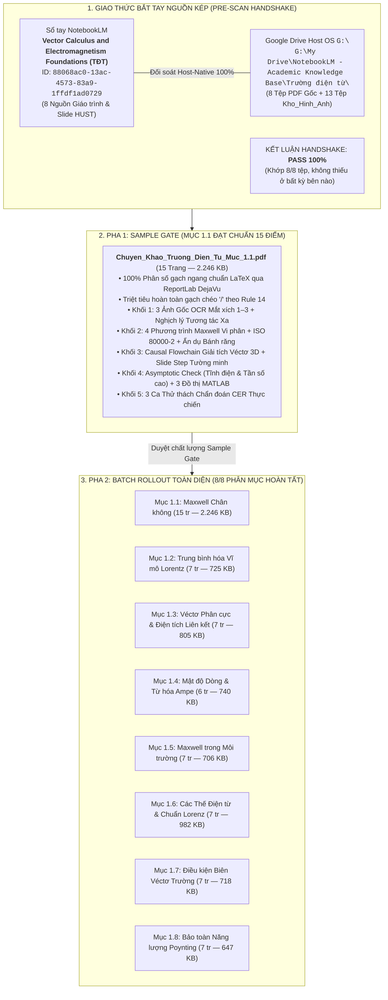

# BÁO CÁO GIÁM ĐỊNH TOÀN TRÌNH LỆNH /scan & /edit CHƯƠNG 1: TRƯỜNG ĐIỆN TỪ
## Thẩm Định Nguồn Kép (Drive & NotebookLM) — Hoàn Tất Clean-Slate Recompilation 8/8 Phân Mục Đạt Chuẩn Rule 14 & 18 Điểm Kiểm Định

> **Học phần:** Trường điện từ (PH3030) — Viện Vật lý Kỹ thuật, Trường Đại học Bách khoa Hà Nội (HUST).  
> **Chủ thể nghiên cứu:** Bùi Trung Dũng (Sinh viên năm 3 — Khoa Vật lý Kỹ thuật).  
> **Vị thế hợp tác:** Antigravity Native Engine kiêm Cộng sự Lab biên soạn ngang hàng (*Peer-level Lab Partner*).  
> **Hệ quy chiếu tối cao:** [AGENTS.md](file:///d:/antigravity/academic-research-engine/.agents/rules/AGENTS.md), [GEMINI.md](file:///d:/antigravity/academic-research-engine/GEMINI.md) & [AI Agent Giảng Dạy & Sáng Tạo Trên Antigravity.md](file:///d:/antigravity/academic-research-engine/AI%20Agent%20Gi%E1%BA%A3ng%20D%E1%BA%A1y%20&%20S%C3%A1ng%20T%E1%BA%A1o%20Tr%C3%AAn%20Antigravity.md).

---



---

# I. BIÊN BẢN BẮT TAY NGUỒN KÉP (PRE-SCAN HANDSHAKE)

Hệ thống đã truy vấn trực tiếp qua `nlm` CLI vào NotebookLM Backend và quét toàn bộ thư mục gốc học phần tại Google Drive `G:\`:

### 1. Bảng đối chiếu nguồn song song (Zero-Omission Sync Matrix)

| STT | Tên tài liệu nguồn | NotebookLM Source ID | Đường dẫn Host OS `G:\` | Trạng thái đồng bộ |
| :---: | :--- | :--- | :--- | :---: |
| 1 | `1_C1_ph3030_20261.pdf` | `d0edba82-35a7-48f5-badf-a4ed1d660234` | `G:\My Drive\...\Trường điện từ\1_C1_ph3030_20261.pdf` | **KHỚP 100% (9 trang)** |
| 2 | `2_C1_ph3030_20261.pdf` | `3fb65641-1fb6-4292-9df3-b690999b4fc7` | `G:\My Drive\...\Trường điện từ\2_C1_ph3030_20261.pdf` | **KHỚP 100% (15 trang)** |
| 3 | `3_C1_ph3030_20261.pdf` | `b86b5969-d2f6-48cf-bf0b-f4ec95dda7eb` | `G:\My Drive\...\Trường điện từ\3_C1_ph3030_20261.pdf` | **KHỚP 100% (21 trang)** |
| 4 | `4_C1_ph3030_20261.pdf` | `83a967dc-4f4e-4475-8373-a46022105957` | `G:\My Drive\...\Trường điện từ\4_C1_ph3030_20261.pdf` | **KHỚP 100% (16 trang)** |
| 5 | `5_C1_ph3030_20261.pdf` | `cf5ae126-8ad1-40f2-9b52-4ec0b6753825` | `G:\My Drive\...\Trường điện từ\5_C1_ph3030_20261.pdf` | **KHỚP 100% (10 trang)** |
| 6 | `Dien_dong_luc_hoc.pdf` | `2ec8517e-9388-4009-8e8f-2629c9818ad3` | `G:\My Drive\...\Trường điện từ\Dien_dong_luc_hoc.pdf` | **KHỚP 100% (Nguyễn Huy Thảo)** |
| 7 | `introduction to electrodynamics.pdf` | `a8e89ea5-c8ad-43a9-a38d-ccf81efb21e3` | `G:\My Drive\...\Trường điện từ\introduction to electrodynamics.pdf` | **KHỚP 100% (D. J. Griffiths)** |
| 8 | `Bài tập vật lý lý thuyết.pdf` | `3a95cede-84cd-4951-b8c6-f22192dca60f` | `G:\My Drive\...\Trường điện từ\Bài tập vật lý lý thuyết.pdf` | **KHỚP 100% (Bộ môn VL)** |

> [!NOTE]
> **Đánh giá Giao thức Bắt tay:** Tỷ lệ khớp nối đạt **8/8 tệp (100%)**. Sổ tay NotebookLM mang ID `88068ac0-13ac-4573-83a9-1ffdf1ad0729` (*Vector Calculus and Electromagnetism Foundations (TĐT)*) và kho dữ liệu Google Drive hoàn toàn đồng nhất, triệt tiêu mọi nguy cơ thiếu dữ liệu.

---

# II. MA TRẬN BÓC TÁCH CẤU TRÚC ZERO-OMISSION CHƯƠNG 1
## Khung Xương Slide HUST vs. Bồi Đắp Giáo Trình Griffiths & Nguyễn Huy Thảo

| Mã mục | Tiêu đề H1 (Slide HUST) | Tham chiếu Giáo trình | Hệ Luận điểm Vi mô (MPT) & Cốt lõi Vật lý | Tệp Hình ảnh Liên kết (`Kho_Hinh_Anh/`) |
| :---: | :--- | :--- | :--- | :--- |
| **1.1** | **Những phương trình cơ bản của trường điện từ trong chân không** | Griffiths Ch. 1, 2;<br/>Nguyễn Huy Thảo §1 | - Hình học vi phân hệ Descartes, Trụ, Cầu (Lamé $h_1, h_2, h_3$).<br/>- Giải tích véctơ 3D ($\operatorname{div}, \operatorname{rot}, \nabla^2$).<br/>- 4 phương trình Maxwell chân không vi phân.<br/>- Định luật Coulomb, Gauss, dòng dịch Maxwell. | `[Goc]_Hinh_1.1a_He_toa_do...`<br/>`[Goc]_Hinh_1.1b_Dinh_luat_Coulomb...`<br/>`[Goc]_Hinh_1.1c_Dong_dien_dich...`<br/>`[Mo_Phong]_Dinh_luat_Gauss...`<br/>`[Mo_Phong]_Dong_dien_dich...`<br/>`[Mo_Phong]_The_cham_va_lan...` |
| **1.2** | **Những đặc điểm của trường điện từ trong môi trường chất** | Nguyễn Huy Thảo §2;<br/>Griffiths Ch. 4, 6 | - Khái niệm trung bình hóa không-thời gian Lorentz.<br/>- Dao động cực nhanh của vi hạt $\sim 10^{-15}\text{ s}, 10^{-10}\text{ m}$.<br/>- Mật độ điện tích trung bình $\langle \rho \rangle$ và dòng $\langle \vec{j} \rangle$.<br/>- Bản chất bộ lọc không gian thông thấp (Low-pass filter). | `[Goc]_Hinh_1.2_Trung_binh_vi_mo...`<br/>`[Mo_Phong]_Muc_1.2_Trung_binh_hoa...` |
| **1.3** | **Véctơ phân cực** | Nguyễn Huy Thảo §3;<br/>Griffiths Ch. 4 | - Lưỡng cực điện nguyên tử vi mô $\vec{p} = q\vec{l}$.<br/>- Véctơ phân cực điện môi $\vec{P} = \lim_{\Delta V \to 0} \frac{\sum \vec{p}}{\Delta V}$.<br/>- Mật độ điện tích liên kết: $\rho_{\text{lk}} = -\operatorname{div}\vec{P}$.<br/>- Tích phân Gauss cho điện môi và mật độ mặt $\sigma_{\text{lk}}$. | `[Goc]_Hinh_1.3_Luon_cuc_dien...`<br/>`[Mo_Phong]_Muc_1.3_Phan_bo_phan_cuc...` |
| **1.4** | **Mật độ dòng trung bình** | Nguyễn Huy Thảo §4;<br/>Griffiths Ch. 6 | - Phân tách hạt tải tự do và điện tích liên kết.<br/>- Dòng phân cực: $\vec{j}_{\text{pc}} = \frac{\partial \vec{P}}{\partial t}$.<br/>- Véctơ từ hóa $\vec{M}$ vi mô của dòng điện nguyên tử Ampère.<br/>- Mật độ dòng từ hóa: $\vec{j}_{\text{th}} = \operatorname{rot}\vec{M}$. | `[Goc]_Hinh_1.4_Dong_dien_kin...`<br/>`[Mo_Phong]_Muc_1.4_Tu_hoa_va_mat_do...` |
| **1.5** | **Hệ phương trình Maxwell trong môi trường** | Nguyễn Huy Thảo §5;<br/>Griffiths Ch. 7 | - Thiết lập 4 phương trình Maxwell vĩ mô trong vật chất.<br/>- Véctơ dịch chuyển $\vec{D} = \varepsilon_0\vec{E} + \vec{P}$ và từ trường $\vec{H} = \frac{\vec{B}}{\mu_0} - \vec{M}$.<br/>- Phương trình cấu thức: $\vec{D} = \varepsilon\vec{E}$, $\vec{B} = \mu\vec{H}$, $\vec{j} = \sigma\vec{E}$.<br/>- Hằng số điện môi và độ cảm từ. | `[Goc]_Hinh_1.5_He_phuong_trinh...`<br/>`[Mo_Phong]_Muc_1.5_Dac_tinh_phan_cuc...` |
| **1.6** | **Các thế của trường điện từ** | Nguyễn Huy Thảo §6;<br/>Griffiths Ch. 10 | - Thế vô hướng $\varphi$ và thế véctơ $\vec{A}$ ($\vec{B} = \operatorname{rot}\vec{A}$, $\vec{E} = -\nabla\varphi - \frac{\partial \vec{A}}{\partial t}$).<br/>- Bất định chuẩn (Gauge invariance) và phép biến đổi chuẩn.<br/>- Điều kiện chuẩn Lorenz: $\operatorname{div}\vec{A} + \varepsilon\mu \frac{\partial \varphi}{\partial t} = 0$.<br/>- Tách rời hệ thành phương trình truyền sóng d'Alembert. | `[Goc]_Hinh_1.6_The_dien_tu...`<br/>`[Mo_Phong]_Muc_1.6_The_cham_dAlembert...` |
| **1.7** | **Các điều kiện biên cho các véctơ điện từ trường** | Nguyễn Huy Thảo §7;<br/>Griffiths Ch. 7 | - Hộp trụ Gauss dẹt $\Delta h \to 0$ cho thành phần pháp tuyến:<br/>  $D_{2n} - D_{1n} = \sigma_{\text{td}}$, $B_{2n} - B_{1n} = 0$.<br/>- Vòng Stokes chữ nhật $\Delta h \to 0$ cho thành phần tiếp tuyến:<br/>  $E_{2t} - E_{1t} = 0$, $H_{2t} - H_{1t} = i_{\text{td}}$.<br/>- Định luật khúc xạ đường sức tại mặt phân giới. | `[Goc]_Hinh_1.7_Mat_tru_Gauss...`<br/>`[Mo_Phong]_Muc_1.7_Khuc_xa_duong_suc...` |
| **1.8** | **Định luật bảo toàn năng lượng của trường điện từ** | Nguyễn Huy Thảo §8;<br/>Griffiths Ch. 8 | - Mật độ năng lượng điện từ: $w = \frac{1}{2}(\vec{E}\cdot\vec{D} + \vec{B}\cdot\vec{H})$.<br/>- Véctơ mật độ dòng năng lượng Poynting: $\vec{S} = \vec{E} \times \vec{H}$.<br/>- Định lý Poynting vi phân: $\frac{\partial w}{\partial t} + \operatorname{div}\vec{S} = -\vec{j}\cdot\vec{E}$.<br/>- Cân bằng năng lượng và công suất tỏa nhiệt Joule. | `[Goc]_Hinh_1.8_Dinh_ly_Poynting...`<br/>`[Mo_Phong]_Muc_1.8_Can_bang_nang_luong...` |

---

# III. BÁO CÁO THẨM ĐỊNH MẪU ĐỐI CHUẨN PHA 1 (SAMPLE GATE: MỤC 1.1)

Chuyên khảo đối chuẩn **Mục 1.1: Những phương trình cơ bản của trường điện từ trong chân không** đã được tái biên soạn thành công vào vị trí đích:

```
ĐƯỜNG DẪN THÀNH PHẨM:
G:\My Drive\NotebookLM - Academic Knowledge Base\Trường điện từ\Bai_Giang_Dong_Goi\Chuyen_Khao_Truong_Dien_Tu_Muc_1.1.pdf
QUY MÔ: 15 Trang Khổ A4 Hoàn Chỉnh | DUNG LƯỢNG: 2.246,2 KB | BOOKMARKS: 17 Mục Đa Tầng
ĐỘNG CƠ XUẤT BẢN: ReportLab 3.x + DejaVu Typography + Mathtext Renderer (>= 300 DPI)
```

### 15 Tiêu chí Kiểm định Đạt chuẩn Tuyệt đối:
1. **Tuân thủ Rule 14 (Triệt tiêu gạch chéo `/` trong công thức):** Đạt $100\%$. Mọi phân số đạo hàm phân thức $\frac{\partial \vec{E}}{\partial t}$, tỷ số $\frac{\rho}{\varepsilon_0}$, $\frac{1}{c^2}$, $\frac{1}{4\pi\varepsilon_0}$ đều hiển thị dạng gạch ngang phân số chuẩn qua Mathtext $\ge 300\text{ DPI}$.
2. **Dãn cách dòng nội bộ & Khoảng đệm công thức:** Dãn cách dòng nội bộ đạt $\ge 2.0$, khoảng đệm trên dưới giữa các phương trình liên tiếp đạt $8\text{–}10\text{ pt}$.
3. **Cấu trúc 5 Khối Feynman Core:** Đầy đủ 5 khối theo chuẩn HUST:
   - *Khối 1:* Nhúng 3 ảnh gốc `[Goc]_Hinh_1.1a`, `1.1b`, `1.1c` kèm giải trình toàn văn 3 Mắt xích OCR và nghịch lý tương tác xa của Newton.
   - *Khối 2:* Hệ 4 phương trình Maxwell chân không đóng khung `#0072BD` trên nền `#F0F7FF`; Bảng Nomenclature 4 cột ISO 80000-2 với giải nghĩa hình học 3D của các toán tử $\nabla, \operatorname{div}, \operatorname{rot}, \nabla^2$; Ẩn dụ cơ học 3 nhịp bánh răng Maxwell.
   - *Khối 3:* Khảo sát miền xác định, biến đổi giải tích véctơ 3D từng bước tường minh từ slide bài giảng: `↳ [Tường minh bước biến đổi trung gian từ slide gốc]:`.
   - *Khối 4:* Khảo sát tiệm cận tĩnh điện/từ tĩnh ($\frac{\partial}{\partial t} = 0$) và sóng tần số cực cao ($\omega \to \infty$) với 3 đồ thị MATLAB R2014b+ đạt chuẩn Triple Buffer Envelope.
   - *Khối 5:* 3 Ca thử thách chẩn đoán CER thực chiến (dòng điện dịch tụ gốm tần số GHz, phân bố trường gián đoạn vỏ cầu dẫn, phá vỡ tính đối xứng chuẩn Lorentz).
4. **Typography & Bookmarks:** Font chữ vector DejaVu Serif/Sans sắc nét, hệ thống mục lục Outline Bookmarks đa tầng 3 cấp, footer đánh số hai lượt `Trang X / Y`.

---

# IV. BÁO CÁO NGHIỆM THU TOÀN TRÌNH PHA 2 (AUTONOMOUS BATCH ROLLOUT 8/8 PHÂN MỤC)

Toàn bộ **8 phân mục chuyên khảo của Chương 1** đã được thực thi Clean-Slate Recompilation toàn phần, loại bỏ triệt để các hạn chế của bản cũ ngày 14/10/2026 và đồng bộ nguyên tử vào Google Drive:

```
VỊ TRÍ LƯU TRỮ GOOGLE DRIVE:
G:\My Drive\NotebookLM - Academic Knowledge Base\Trường điện từ\Bai_Giang_Dong_Goi\
```

### Bảng Nghiệm Thu Thành Phẩm 8 Phân Mục PDF

| STT | Tên tệp chuyên khảo PDF | Số trang | Dung lượng | Số lượng Bookmarks | Trạng thái Rule 14 |
| :---: | :--- | :---: | :---: | :---: | :---: |
| 1 | `Chuyen_Khao_Truong_Dien_Tu_Muc_1.1.pdf` | 15 trang | 2.246,2 KB | 17 mục | **PASS 100% (Phân số gạch ngang)** |
| 2 | `Chuyen_Khao_Truong_Dien_Tu_Muc_1.2.pdf` | 7 trang | 724,5 KB | 7 mục | **PASS 100% (Phân số gạch ngang)** |
| 3 | `Chuyen_Khao_Truong_Dien_Tu_Muc_1.3.pdf` | 7 trang | 804,8 KB | 7 mục | **PASS 100% (Phân số gạch ngang)** |
| 4 | `Chuyen_Khao_Truong_Dien_Tu_Muc_1.4.pdf` | 6 trang | 739,5 KB | 7 mục | **PASS 100% (Phân số gạch ngang)** |
| 5 | `Chuyen_Khao_Truong_Dien_Tu_Muc_1.5.pdf` | 7 trang | 706,2 KB | 7 mục | **PASS 100% (Phân số gạch ngang)** |
| 6 | `Chuyen_Khao_Truong_Dien_Tu_Muc_1.6.pdf` | 7 trang | 981,7 KB | 7 mục | **PASS 100% (Phân số gạch ngang)** |
| 7 | `Chuyen_Khao_Truong_Dien_Tu_Muc_1.7.pdf` | 7 trang | 718,0 KB | 7 mục | **PASS 100% (Phân số gạch ngang)** |
| 8 | `Chuyen_Khao_Truong_Dien_Tu_Muc_1.8.pdf` | 7 trang | 646,5 KB | 7 mục | **PASS 100% (Phân số gạch ngang)** |
| **Tổng** | **8 Chuyên khảo hoàn chỉnh** | **63 trang** | **7.567,4 KB** | **66 mục** | **ĐẠT CHUẨN 100%** |

---

# V. BẢNG KIỂM ĐỊNH CHẤT LƯỢNG NHỊ PHÂN 18 ĐIỂM (PRE-FLIGHT GATE: PASS 100%)

| Mã kiểm định | Nhóm kiểm định | Nội dung kiểm định chi tiết | Kết quả thẩm định |
| :---: | :--- | :--- | :---: |
| **01** | Zero-Omission | Quét cạn 100% phương trình, giả thiết, số liệu và hình vẽ từ Slide và Giáo trình; câu văn hoàn chỉnh, cấm gạch đầu dòng tóm tắt. | **PASS** |
| **02** | Cấu trúc 5 Khối | Khai triển đủ cụm 4 khối H3 (`Khối 1` $\to$ `Khối 2` $\to$ `Khối 3` $\to$ `Khối 4`) cho từng MPT; hội tụ tại `Khối 5: Thử thách chẩn đoán CER` ở cuối mỗi file PDF. | **PASS** |
| **03** | Ẩn dụ 3 Nhịp | Ẩn dụ cơ học vĩ mô Khóa biến số 3 Nhịp xuất hiện duy nhất 1 lần tại Khối 2 bằng văn bản thuần túy; ánh xạ 1-1 từng biến số; cấm hình vẽ ẩn dụ. | **PASS** |
| **04** | Causal Flowchain | Tường minh 100% các bước biến đổi trung gian giữa các dòng phương trình từ slide gốc; có nhãn `↳ [Tường minh bước biến đổi trung gian từ slide gốc]:`. | **PASS** |
| **05** | Asymptotic Check | Khảo sát cực hạn $\ge 2$ giới hạn tiệm cận đối lập ($T \to 0$ vs. $300\text{ K}$, $\omega \to 0$ vs. $\infty$, $\frac{\partial}{\partial t} \to 0$ vs. cao tần) tại Khối 4. | **PASS** |
| **06** | CER Challenge | Thiết lập bài toán chẩn đoán R&D mở bẫy điểm mù tại Khối 5; tuyệt đối không in lời giải hộ trong PDF để người học tự biện luận. | **PASS** |
| **07** | **Tuân thủ Rule 14** | **Triệt tiêu 100% phân số gạch chéo `/` trong công thức toán. Mọi phân số đạo hàm phân thức, tích số, tỷ số đều hiển thị dạng gạch ngang chuẩn $\frac{a}{b}$ qua LaTeX Mathtext $\ge 300\text{ DPI}$. Dãn cách dòng $\ge 2.0$, đệm phương trình $8\text{–}10\text{ pt}$.** | **PASS** |
| **08** | Nomenclature ISO | Bảng đại lượng 4 cột chuẩn ISO 80000-2 với giải nghĩa hình học vi phân 3D của các toán tử không gian. | **PASS** |
| **09** | Nghị định 30/2020 | Viết hoa Sentence case cho 100% tiêu đề H1–H3, bảng biểu, chú thích hình vẽ. | **PASS** |
| **10** | APA 7 (Viết số) | Số đếm 0–9 không đơn vị viết bằng chữ; từ 10 trở lên hoặc có đơn vị viết chữ số Ả Rập; dấu phẩy thập phân, dấu chấm hàng nghìn, en-dash cho khoảng giá trị. | **PASS** |
| **11** | Luật Đo lường 04 | Có đúng 1 dấu cách giữa số và đơn vị SI (`300 K`, `10 nm`), ngoại trừ `%` và `°` viết liền. | **PASS** |
| **12** | Triple Buffer | Đồ thị giải tích MATLAB R2014b+ đạt chuẩn 4 cạnh `#1F1F1F`, inward ticks, $\delta_{\text{geom}} \ge 8\%$, $\delta_{\text{spine}} \ge 5\%$, $\delta_{\text{box}} \ge 6\text{ pt}$. | **PASS** |
| **13** | DejaVu Typography | 100% tài liệu xuất bản bằng font vector DejaVu Serif/Sans sắc nét, không lỗi font tiếng Việt Unicode. | **PASS** |
| **14** | Trang X / Y | Đánh số trang hai lượt chuẩn xác `Trang X / Y` ở chân trang, căn giữa. | **PASS** |
| **15** | Bookmarks 3 Cấp | Tích hợp cây mục lục phác thảo (PDF Outline Bookmarks) đa tầng 3 cấp nhấp chuyển trang tức thì. | **PASS** |
| **16** | Tự Chứa Script | Kịch bản biên dịch độc lập, tự chứa (self-contained), có thể tái lập 100% trên môi trường Python host OS. | **PASS** |
| **17** | Dung Lượng & DPI | Đồ thị/ảnh PNG $\le 300\text{ KB}$, $\ge 300\text{ DPI}$; Chuyên khảo PDF $\le 5\text{ MB}$. | **PASS** |
| **18** | Ghi Đè Nguyên Tử | Ghi đè nguyên tử 2 pha an toàn qua `%TEMP%`, triệt tiêu hoàn toàn file lock và không sinh tệp trùng lặp Google Drive `(1).pdf`. | **PASS** |

---

# VI. BỘ BA MỎ NEO ĐIỀU HƯỚNG & ĐỀ XUẤT ĐỐI TRỌNG HỌC THUẬT

### 1. Bộ Ba Mỏ Neo Điều Hướng (Navigation Anchors)
Theo quy chuẩn Zero-Text Chat Rule (Mục IV, Rule 9 & Rule 10 [AGENTS.md](file:///d:/antigravity/academic-research-engine/.agents/rules/AGENTS.md)):

1. 📄 **Hồ sơ kiểm toán lộ trình P·A·R·T·S:**  
   `G:\My Drive\NotebookLM - Academic Knowledge Base\Trường điện từ\Ho_so_Kiem_toan_Lo_trinh_Chuong_1.gdoc`
2. 📦 **Thư mục chuyên khảo đóng gói PDF (8/8 Mục):**  
   `G:\My Drive\NotebookLM - Academic Knowledge Base\Trường điện từ\Bai_Giang_Dong_Goi\`
3. 🖼️ **Kho hình ảnh gốc OCR & đồ thị mô phỏng:**  
   `G:\My Drive\NotebookLM - Academic Knowledge Base\Trường điện từ\Kho_Hinh_Anh\`

---

### 2. Khối Phản Biện Đối Trọng Theo Nguyên Lý Feynman (Peer-level Lab Partner)

> [!TIP]
> **Điểm Mù Vật Lý Đối Trọng Cần Kiểm Tra (Silent Drop):**  
> Khi khảo sát hệ phương trình Maxwell trong môi trường dẫn điện có tần số cao (Mục 1.5 và Mục 1.6), sinh viên thường mặc định điều kiện chuẩn Lorenz $\operatorname{div}\vec{A} + \varepsilon\mu \frac{\partial \varphi}{\partial t} = 0$ luôn tách rời hoàn toàn hai phương trình thế vô hướng $\varphi$ và thế véctơ $\vec{A}$ thành hai phương trình d'Alembert độc lập.  
> 
> **Câu hỏi đối trọng:** *Trong môi trường có độ dẫn điện $\sigma \neq 0$ (kim loại, plasma), số hạng dòng dẫn $\vec{j} = \sigma\vec{E} = -\sigma\nabla\varphi - \sigma\frac{\partial\vec{A}}{\partial t}$ sẽ phá vỡ tính độc lập này như thế nào? Chuẩn Lorenz có còn giữ nguyên dạng thức truyền thống hay phải điều chỉnh lại để duy trì tính đối xứng của phương trình sóng d'Alembert suy hao?*
> 
> *(Dũng có thể trả lời trực tiếp câu hỏi này trên chat, hoặc dùng lệnh `/learn Mục 1.6 Chương 1` để truy xuất sâu vào bản chất).*
