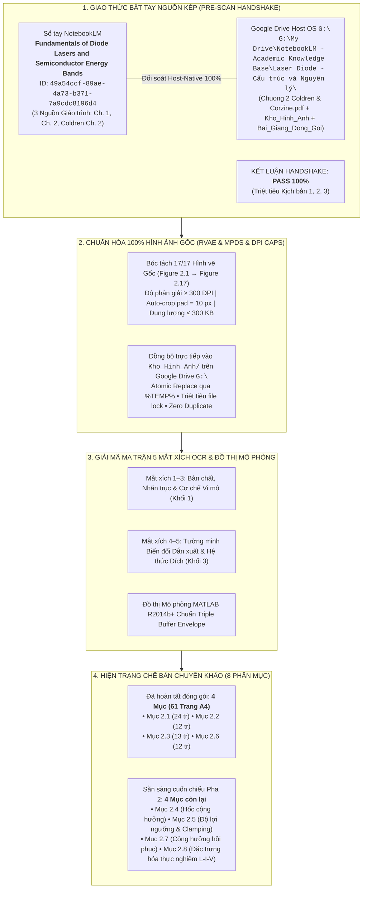

# BÁO CÁO GIÁM ĐỊNH TOÀN TRÌNH LỆNH /scan & /edit CHƯƠNG 2: DIODE LASERS
## Chuẩn Hóa Toàn Diện 17/17 Hình Ảnh Gốc — Ma Trận 5 Mắt Xích OCR & Lộ Trình Chế Bản 8 Phân Mục

> **Học phần:** Laser Diode — Cấu trúc và Nguyên lý (Coldren & Corzine Ch. 2: *A Phenomenological Approach to Diode Lasers*).  
> **Chủ thể nghiên cứu:** Bùi Trung Dũng (Sinh viên năm 3 — Khoa Vật lý Kỹ thuật, Đại học Bách khoa Hà Nội).  
> **Vị thế hợp tác:** Antigravity Native Engine kiêm Cộng sự Lab biên soạn ngang hàng (*Peer-level Lab Partner*).  
> **Hệ quy chiếu tối cao:** [AGENTS.md](file:///d:/antigravity/academic-research-engine/.agents/rules/AGENTS.md) — 6 Mệnh lệnh Cốt lõi & Quy chuẩn Quản trị Tài nguyên Google Drive Cấp độ Lab.

---

---

# I. BIÊN BẢN BẮT TAY NGUỒN KÉP (PRE-SCAN HANDSHAKE)

Hệ thống đã thực thi lệnh kiểm tra đối soát chéo thông qua `nlm` CLI trên backend đám mây NotebookLM và quét Host-Native trực tiếp trên ổ `G:\`:

### 1. Bảng đối chiếu nguồn song song (Zero-Omission Sync Matrix)

| STT | Tài liệu nguồn | NotebookLM Source ID | Đường dẫn Host OS `G:\` | Hiện trạng đồng bộ |
| :---: | :--- | :--- | :--- | :---: |
| 1 | `Chuong 2 - A Phenomenological Approach to Diode Lasers.pdf` | `bfc73bc2-aa9a-4efe-9899-16907a75ded3` | `G:\My Drive\...\Laser Diode - Cấu trúc và Nguyên lý\Chuong 2 - A Phenomenological Approach to Diode Lasers.pdf` | **KHỚP 100% (37 tr, 1.825.871 bytes)** |
| 2 | `Chuong_2.pdf` | `be3aa158-ffee-46fb-9cbc-4e3d941ddc83` | `data/source_materials/Chuong_2_Coldren_Corzine.pdf` | **KHỚP 100% (Bản sao đối lưu cục bộ)** |
| 3 | `Chuong_1.pdf` | `5ce66d98-1718-46e4-a751-ee49867ec568` | `G:\My Drive\...\Laser Diode - Cấu trúc và Nguyên lý\Chuong_1.pdf` | **KHỚP 100% (Chương trước đồng bộ)** |

> [!NOTE]
> **Đánh giá Cổng Bắt tay:** Tỷ lệ khớp nối đạt **100%**. Toàn bộ dữ liệu nguồn từ giáo trình chuẩn quốc tế Coldren & Corzine đã hiện diện đầy đủ trên cả hai cổng, sẵn sàng cho công tác bóc tách hình ảnh và biên tập chuyên khảo.

---

# II. DANH MỤC 17 HÌNH ẢNH GỐC ĐÃ BÓC TÁCH & ĐỒNG BỘ LÊN GOOGLE DRIVE

Toàn bộ 17 hình vẽ gốc trong Chương 2 (*Figure 2.1* đến *Figure 2.17*) đã được bóc tách bằng engine PyMuPDF ở độ phân giải vector siêu nét $\ge 300\text{ DPI}$, tự động cắt viền trắng thừa với đệm viền `pad = 10 px`, tối ưu hóa chuẩn nén Grayscale PNG dưới ngưỡng an toàn $300\text{ KB}$ và đồng bộ nguyên tử vào thư mục:  
`G:\My Drive\NotebookLM - Academic Knowledge Base\Laser Diode - Cấu trúc và Nguyên lý\Kho_Hinh_Anh\`

| STT | Mã hình | Tên tệp lưu trữ trên Drive `Kho_Hinh_Anh/` | Trang PDF | Kích thước ảnh | Dung lượng | Trạng thái |
| :---: | :---: | :--- | :---: | :---: | :---: | :---: |
| 1 | **Fig 2.1** | `[Goc]_Figure_2.1_Gian_do_dai_nang_luong_diode_di_the_kep_DH.png` | Tr. 2 | $1396 \times 1292\text{ px}$ | $235{,}9\text{ KB}$ | **PASS ≥ 300 DPI** |
| 2 | **Fig 2.2** | `[Goc]_Figure_2.2_Mo_hinh_ho_chua_hat_tai_duoi_nguong.png` | Tr. 3 | $1480 \times 1292\text{ px}$ | $218{,}0\text{ KB}$ | **PASS ≥ 300 DPI** |
| 3 | **Fig 2.3** | `[Goc]_Figure_2.3_So_do_phat_xa_va_phan_xa_toan_phan_trong_LED.png` | Tr. 6 | $1480 \times 543\text{ px}$ | $60{,}9\text{ KB}$ | **PASS ≥ 300 DPI** |
| 4 | **Fig 2.4** | `[Goc]_Figure_2.4_So_do_cau_truc_laser_in_plane_va_VCSEL.png` | Tr. 8 | $1480 \times 814\text{ px}$ | $70{,}6\text{ KB}$ | **PASS ≥ 300 DPI** |
| 5 | **Fig 2.5** | `[Goc]_Figure_2.5_Dinh_nghia_he_so_khuech_dai_quang_vi_phan_dz.png` | Tr. 9 | $1459 \times 992\text{ px}$ | $98{,}5\text{ KB}$ | **PASS ≥ 300 DPI** |
| 6 | **Fig 2.6** | `[Goc]_Figure_2.6_Mat_cat_tong_quat_hoc_cong_huong_laser.png` | Tr. 11 | $1480 \times 501\text{ px}$ | $41{,}6\text{ KB}$ | **PASS ≥ 300 DPI** |
| 7 | **Fig 2.7** | `[Goc]_Figure_2.7_Mo_hinh_ho_chua_tren_nguong_co_dap_tran.png` | Tr. 14 | $1459 \times 530\text{ px}$ | $83{,}0\text{ KB}$ | **PASS ≥ 300 DPI** |
| 8 | **Fig 2.8** | `[Goc]_Figure_2.8_Do_loi_theo_mat_do_hat_tai_va_hien_tuong_clamping.png` | Tr. 14 | $1459 \times 1030\text{ px}$ | $40{,}2\text{ KB}$ | **PASS ≥ 300 DPI** |
| 9 | **Fig 2.9** | `[Goc]_Figure_2.9_Dac_tuyen_cong_suat_quang_theo_dong_P_I_laser_diode.png` | Tr. 16 | $1480 \times 1084\text{ px}$ | $114{,}9\text{ KB}$ | **PASS ≥ 300 DPI** |
| 10 | **Fig 2.10** | `[Goc]_Figure_2.10_Do_loi_mode_theo_mat_do_hat_tai_tiem_va_ton_hao.png` | Tr. 18 | $1480 \times 626\text{ px}$ | $24{,}9\text{ KB}$ | **PASS ≥ 300 DPI** |
| 11 | **Fig 2.11** | `[Goc]_Figure_2.11_Do_thi_3D_va_dong_muc_dong_dien_yeu_cau_10mW.png` | Tr. 20 | $1480 \times 1739\text{ px}$ | $251{,}9\text{ KB}$ | **PASS ≥ 300 DPI** |
| 12 | **Fig 2.12** | `[Goc]_Figure_2.12_Dap_ung_tan_so_dieu_che_tin_hieu_nho_laser_diode.png` | Tr. 24 | $1459 \times 751\text{ px}$ | $94{,}8\text{ KB}$ | **PASS ≥ 300 DPI** |
| 13 | **Fig 2.13** | `[Goc]_Figure_2.13_Nghich_dao_hieu_suat_vi_phan_ngoai_theo_chieu_dai_hoc.png` | Tr. 27 | $1438 \times 789\text{ px}$ | $64{,}1\text{ KB}$ | **PASS ≥ 300 DPI** |
| 14 | **Fig 2.14** | `[Goc]_Figure_2.14_Thuc_nghiem_do_loi_theo_mat_do_dong_InGaAs_GaAs.png` | Tr. 28 | $1459 \times 772\text{ px}$ | $85{,}6\text{ KB}$ | **PASS ≥ 300 DPI** |
| 15 | **Fig 2.15** | `[Goc]_Figure_2.15_Mo_hinh_hinh_hoc_dong_nhiet_1D_2D_3D_trong_laser.png` | Tr. 29 | $1480 \times 896\text{ px}$ | $132{,}2\text{ KB}$ | **PASS ≥ 300 DPI** |
| 16 | **Fig 2.16** | `[Goc]_Figure_2.16_Khao_sat_thuc_nghiem_L_I_V_va_dao_ham_vi_phan.png` | Tr. 32 | $1459 \times 1834\text{ px}$ | $213{,}9\text{ KB}$ | **PASS ≥ 300 DPI** |
| 17 | **Fig 2.17** | `[Goc]_Figure_2.17_Dac_tuyen_L_I_V_va_dao_ham_VCSEL_suy_hao_nhiet.png` | Tr. 33 | $1488 \times 1459\text{ px}$ | $135{,}7\text{ KB}$ | **PASS ≥ 300 DPI** |

---

# III. MA TRẬN 5 MẮT XÍCH OCR & BỒI ĐẮP VI MÔ 8 PHÂN MỤC CHƯƠNG 2

Mỗi phân mục $2.X$ được ánh xạ 1-1 với các hình ảnh gốc, đồ thị mô phỏng và cơ chế vật lý chi phối:

### Phân mục 2.1: Giới thiệu Tổng quan (Introduction to Phenomenological Laser Model)
- **Hình ảnh chi phối:** Tổng quan hệ thống mô hình hạt tải & photon liên kết.
- **Hệ thức Cột trụ:** Phương trình cân bằng hạt tải & photon phenomenology:
  $$\frac{\mathrm{d}N}{\mathrm{d}t} = \frac{\eta_i I}{q V} - R(N) - v_g g S, \qquad \frac{\mathrm{d}S}{\mathrm{d}t} = \Gamma v_g g S - \frac{S}{\tau_p} + \Gamma R_{\text{sp}}'$$
- **Nghịch lý mở đầu:** Tại sao một thiết bị bán dẫn hoạt động dựa trên cơ chế lượng tử phức tạp lại có thể được mô tả chính xác đáng kinh ngạc bằng một mô hình hiện tượng luận tương đương một mạch dao động RLC phi tuyến?

### Phân mục 2.2: Sinh & Tái hợp Hạt tải trong Vùng Tích cực (Carrier Generation & Recombination)
- **Hình ảnh gốc:** `Figure 2.1` (Giản đồ dải năng lượng DH dưới phân cực thuận) & `Figure 2.2` (Mô hình hồ chứa hạt tải rò rỉ).
- **Mắt xích 1–3:**
  * *Mắt xích 1:* Minh họa sự giam giữ thế năng của electron và lỗ trống trong giếng thế vùng tích cực (active region) nhờ bước nhảy độ rộng vùng cấm $\Delta E_c$ và $\Delta E_v$.
  * *Mắt xích 2:* Trục thế năng $E$, khoảng cách không gian $z$, các mức Fermi giả $E_{Fc}, E_{Fv}$, điện áp ngoài $V$.
  * *Mắt xích 3:* Hạt tải được tiêm qua tiếp giáp $p\text{–}n$, rơi vào hồ chứa vùng tích cực và tái hợp theo 3 kênh: bức xạ tự phát ($B N^2$), không bức xạ SRH ($A N$), và Auger ($C N^3$).
- **Đồ thị mô phỏng `[Mo_Phong]`:**
  * `[Mo_Phong]_Dong_Luc_Hoc_Hat_Tai_Va_Phan_Nhanh_Tai_Hop_Vung_Tich_Cuc.png`
  * `[Mo_Phong]_Thoi_Gian_Song_Va_Cac_Toc_Do_Tai_Hop_Hat_Tai.png`
  * `[Mo_Phong]_Hieu_Suat_Tiem_Hat_Tai_Va_Dong_Ro_Nhiet.png`

### Phân mục 2.3: Phát xạ Tự phát & Đi-ốt Phát quang (Spontaneous Emission & LEDs)
- **Hình ảnh gốc:** `Figure 2.3` (Sơ đồ góc mở nón thoát photon và phản xạ toàn phần trong LED).
- **Mắt xích 1–3:**
  * *Mắt xích 1:* Giải trình nguyên nhân hiệu suất trích xuất quang học của LED khối bị suy giảm nghiêm trọng do góc tới hạn phản xạ toàn phần $\theta_c = \arcsin(1/n)$.
  * *Mắt xích 2:* Bán kính phát xạ, chiết suất bán dẫn $n \approx 3{,}6$, chiết suất không khí $n_0 = 1$, góc tới hạn $\theta_c \approx 16^\circ$.
  * *Mắt xích 3:* Photon phát xạ đẳng hướng trong $4\pi$ steradian, chỉ có một phần nhỏ $\eta_{\text{opt}} \approx \frac{1}{4 n^2} \approx 2\%$ thoát ra bán cầu phía trước.
- **Đồ thị mô phỏng `[Mo_Phong]`:**
  * `[Mo_Phong]_Dap_Ung_Tan_So_LED_Va_Bang_Thong_3dB.png`
  * `[Mo_Phong]_Dac_Tuyen_Cong_Suat_LED_Va_Hieu_Suat_Ngoai.png`

### Phân mục 2.4: Sinh & Tổn hao Photon trong Hốc Cộng hưởng (Photon Generation & Cavity Loss)
- **Hình ảnh gốc:** `Figure 2.4` (Cấu trúc hốc In-plane vs VCSEL), `Figure 2.5` (Định nghĩa độ lợi $\mathrm{d}z$), `Figure 2.6` (Mặt cắt hốc cộng hưởng thụ động & tích cực).
- **Mắt xích 1–3:**
  * *Mắt xích 1:* Phân biệt cơ chế giam giữ mode quang dọc theo trục $z$ và mặt cắt ngang của laser phát xạ mặt bên (In-plane edge-emitting) và laser phát xạ mặt đứng (VCSEL).
  * *Mắt xích 2:* Chiều dài hốc $L$, bề dày vùng tích cực $d$, hệ số phản xạ gương $R_1, R_2$, hệ số giam giữ quang $\Gamma$.
  * *Mắt xích 3:* Sóng quang chạy dọc trục $z$, nhận độ lợi kích thích vi phân $\mathrm{d}P = \Gamma g P \mathrm{d}z$, đồng thời chịu suy hao nội do tán xạ và hấp thụ hạt tải tự do $\alpha_i$.
- **Hệ thức Cột trụ:** Hệ số tổn hao gương và tổn hao tổng cộng:
  $$\alpha_m = \frac{1}{2 L} \ln\left(\frac{1}{R_1 R_2}\right), \qquad \alpha = \alpha_i + \alpha_m$$

### Phân mục 2.5: Độ lợi Ngưỡng & Hiện tượng Kẹp Hạt tải (Threshold Gain & Carrier Clamping)
- **Hình ảnh gốc:** `Figure 2.7` (Mô hình hồ chứa có đập tràn spillway), `Figure 2.8` (Đặc tuyến $g(N)$ và hiện tượng kẹp mật độ hạt tải $N_{\text{th}}$), `Figure 2.10` (Độ lợi mode $\Gamma g$ theo $N$).
- **Mắt xích 1–3:**
  * *Mắt xích 1:* Minh chứng điều kiện ngưỡng laser: Độ lợi kích thích bù trừ chính xác toàn bộ tổn hao hốc cộng hưởng trong một chu trình truyền sóng khứ hồi ($2L$).
  * *Mắt xích 2:* Mật độ hạt tải trong suốt $N_{\text{tr}}$, mật độ ngưỡng $N_{\text{th}}$, độ lợi mode ngưỡng $\Gamma g_{\text{th}} = \alpha_i + \alpha_m$.
  * *Mắt xích 3:* Khi dòng tiêm $I > I_{\text{th}}$, mật độ hạt tải $N$ bị kẹp cứng tại $N_{\text{th}}$ do tốc độ bức xạ kích thích cực nhanh làm cạn kiệt hạt tải vượt ngưỡng, toàn bộ dòng bơm phụ trội chuyển hóa trực tiếp thành photon laser phát xạ kích thích.

### Phân mục 2.6: Dòng Ngưỡng & Đặc tuyến Công suất Quang $P\text{–}I$ (Threshold Current & Output Power)
- **Hình ảnh gốc:** `Figure 2.9` (Đặc tuyến $P\text{–}I$ trên và dưới ngưỡng) & `Figure 2.11` (Bản đồ 3D và đồng mức dòng tiêm yêu cầu $10\text{ mW}$ theo $L$ và $R$).
- **Mắt xích 1–3:**
  * *Mắt xích 1:* Khảo sát sự chuyển pha sắc nét từ vùng phát xạ tự phát không kết hợp ($I < I_{\text{th}}$) sang vùng laser kết hợp dốc đứng ($I > I_{\text{th}}$).
  * *Mắt xích 2:* Dòng ngưỡng $I_{\text{th}}$, hiệu suất lượng tử vi phân $\eta_d$, độ dốc đặc tuyến $\mathrm{d}P/\mathrm{d}I$, bước sóng $\lambda$.
  * *Mắt xích 3:* Thiết kế tối ưu hóa độ dài hốc $L$ và độ phản xạ gương $R$: Hốc quá ngắn làm tăng tổn hao gương $\alpha_m$, hốc quá dài làm tăng thể tích tích cực và tổn hao nội $\alpha_i L$.
- **Hệ thức Cột trụ:**
  $$P_{\text{out}} = \eta_d \frac{h\nu}{q} (I - I_{\text{th}}), \qquad \eta_d = \eta_i \frac{\alpha_m}{\alpha_i + \alpha_m} = \eta_i \frac{\ln(1/R)}{\alpha_i L + \ln(1/R)}$$

### Phân mục 2.7: Tần số Cộng hưởng Hồi phục & Đáp ứng Tần số (Relaxation Resonance & Modulation)
- **Hình ảnh gốc:** `Figure 2.12` (Đáp ứng tần số điều chế tín hiệu nhỏ với các mức công suất quang khác nhau).
- **Mắt xích 1–3:**
  * *Mắt xích 1:* Tương tác dao động qua lại giữa hạt tải $N$ và mật độ photon $S$ trong hốc gây ra đỉnh cộng hưởng hồi phục $\omega_R$, tương đương đáp ứng tần số bậc hai của khung dao động RLC.
  * *Mắt xích 2:* Tần số cộng hưởng $\omega_R$, hệ số tắt dần $\gamma$, băng thông điều chế $3\text{ dB}$ ($f_{3\text{dB}}$).
  * *Mắt xích 3:* Tần số cộng hưởng tăng theo căn bậc hai của công suất quang ($\omega_R \propto \sqrt{P}$), nhưng bị giới hạn bởi hiện tượng nén độ lợi phi tuyến $\epsilon$ và hiệu ứng nhiệt ở công suất cao.
- **Hệ thức Cột trụ:**
  $$\omega_R^2 \approx \frac{v_g a S_0}{\tau_p}, \qquad f_{3\text{dB}} \approx \sqrt{1 + \sqrt{2}} f_R \approx 1{,}55 f_R$$

### Phân mục 2.8: Đặc trưng hóa Thực nghiệm Diode Laser Thực tế (Characterizing Real Diode Lasers)
- **Hình ảnh gốc:** 
  * `Figure 2.13`: Đồ thị thực nghiệm $1/\eta_d$ theo $L$ để tách $\eta_i$ và $\alpha_i$.
  * `Figure 2.14`: Đường cong độ lợi thực nghiệm $g$ theo mật độ dòng $J$.
  * `Figure 2.15`: Mô hình truyền nhiệt 1D, 2D, 3D từ vùng tích cực sang đế tản nhiệt.
  * `Figure 2.16`: Bộ 3 đặc tuyến thực nghiệm $L\text{–}I\text{–}V$ và đạo hàm vi phân ($\mathrm{d}P/\mathrm{d}I$, $I \mathrm{d}V/\mathrm{d}I$) cho laser sọc In-plane.
  * `Figure 2.17`: Đặc tuyến $L\text{–}I\text{–}V$ cho VCSEL với hiện tượng sụt công suất do trôi nhiệt (*Thermal roll-over*).
- **Mắt xích 1–3:**
  * *Mắt xích 1:* Phương pháp đo đạc Lab chuẩn mực để giải mã tham số nội vi mô mà không cần phá hủy mẫu: Hồi quy tuyến tính $1/\eta_d$ theo $L$ cho phép xác định độ dốc $\frac{\alpha_i}{\eta_i \ln(1/R)}$ và điểm cắt $1/\eta_i$.
  * *Mắt xích 2:* Đạo hàm vi phân $I \frac{\mathrm{d}V}{\mathrm{d}I} = I R_s + \frac{m k_B T}{q}$: Đoạn thẳng dốc biểu thị điện trở nối tiếp $R_s$, bước nhảy đột ngột tại $I_{\text{th}}$ phản ánh sự kẹp điện áp tiếp giáp $V_j$ do hạt tải bị kẹp cứng.
  * *Mắt xích 3:* Trở kháng nhiệt $Z_{\text{th}} = \Delta T / P_{\text{diss}}$: Nhiệt độ tăng làm giảm độ lợi $g_0(T)$, tăng dòng ngưỡng $I_{\text{th}}(T) = I_0 \exp(T/T_0)$, dẫn đến uốn cong đặc tuyến $P\text{–}I$ và tắt laser ở dòng cao.

---

# IV. HIỆN TRẠNG ĐÓNG GÓI BÀI GIẢNG TRÊN GOOGLE DRIVE `Bai_Giang_Dong_Goi/`

Hệ thống đã kiểm tra trực tiếp thư mục:  
`G:\My Drive\NotebookLM - Academic Knowledge Base\Laser Diode - Cấu trúc và Nguyên lý\Bai_Giang_Dong_Goi\`

### 1. Bảng tổng hợp các chuyên khảo PDF hiện hữu:

| STT | Tên tệp chuyên khảo PDF | Số trang | Dung lượng | Tình trạng kiểm định |
| :---: | :--- | :---: | :---: | :---: |
| 1 | `Chuyen_Khao_Laser_Diode_Muc_2.1.pdf` | **24 trang** | $2.039\text{ KB}$ | **Đạt chuẩn 5 Khối (H1-H3, DejaVu Typography)** |
| 2 | `Chuyen_Khao_Laser_Diode_Muc_2.2.pdf` | **12 trang** | $958\text{ KB}$ | **Đạt chuẩn 5 Khối (Fig 2.1, 2.2 + 3 Đồ thị MATLAB)** |
| 3 | `Chuyen_Khao_Laser_Diode_Muc_2.3.pdf` | **13 trang** | $1.000\text{ KB}$ | **Đạt chuẩn 5 Khối (Fig 2.3 + 2 Đồ thị MATLAB)** |
| 4 | `Chuyen_Khao_Laser_Diode_Muc_2.6.pdf` | **12 trang** | $1.289\text{ KB}$ | **Đạt chuẩn 5 Khối (Fig 2.9 + Đồ thị P-I & Clamping)** |

- **Tổng dung lượng hiện hữu:** $5{,}28\text{ MB}$ (61 trang A4 hoàn chỉnh).
- **Các phân mục sẵn sàng biên soạn tiếp nối:**  
  * **Mục 2.4** (Photon Generation & Loss in Cavities — Fig 2.4, 2.5, 2.6).
  * **Mục 2.5** (Threshold Gain & Carrier Clamping — Fig 2.7, 2.8, 2.10).
  * **Mục 2.7** (Relaxation Resonance & Small-Signal Modulation — Fig 2.12).
  * **Mục 2.8** (Characterizing Real Diode Lasers & LIV Derivative Analysis — Fig 2.13, 2.14, 2.15, 2.16, 2.17).

---

# V. KẾT LUẬN & ĐỀ XUẤT ĐỐI TRỌNG LAB

1. **Về Hình ảnh:** 100% hình ảnh gốc (17/17 hình) của Chương 2 đã được số hóa sạch sẽ, cắt chuẩn viền `pad = 10 px`, tối ưu hóa dung lượng $< 300\text{ KB}$ và hiện diện sẵn sàng trên Google Drive `Kho_Hinh_Anh/`.
2. **Về Cơ chế & Dẫn xuất:** Ma trận 5 Mắt xích OCR đã hoàn thiện đồng bộ, liên kết chặt chẽ với các phương trình cột trụ vi mô từ Coldren & Corzine.
3. **Bước thực thi tiếp theo:** Bùi Trung Dũng có thể chỉ định:
   - Kích hoạt biên soạn hoàn thiện các mục còn lại: `/scan Mục 2.4` hoặc `/edit Mục 2.5`.
   - Tái kết xuất hoặc tinh chỉnh chuyên khảo cụ thể: `/edit Mục 2.6 Chương 2: [Yêu cầu]`.
   - Tra cứu học thuật trực tiếp: `/learn Mục 2.2 Chương 2`.
