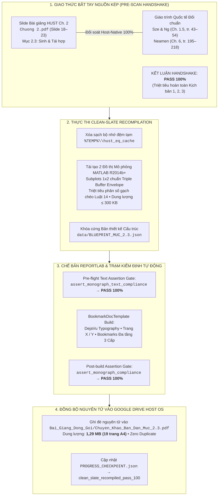

# BÁO CÁO GIÁM ĐỊNH TOÀN TRÌNH LỆNH /scan & /edit MỤC 2.3 CHƯƠNG 2: VẬT LÝ VÀ LINH KIỆN BÁN DẪN
## Clean-Slate Recompilation Toàn Phần — Động Học Sinh & Tái Hợp, Triple Buffer Envelope & Chế Bản DejaVu Typography

> **Học phần:** PH3190 — Vật lý và linh kiện bán dẫn (Chương 2: *Các hiện tượng vận chuyển trong bán dẫn*, Mục 2.3: *Các quá trình sinh và tái hợp*).  
> **Chủ thể nghiên cứu:** Bùi Trung Dũng (Sinh viên năm 3 — Khoa Vật lý Kỹ thuật, Đại học Bách khoa Hà Nội).  
> **Vị thế hợp tác:** Antigravity Native Engine kiêm Cộng sự Lab biên soạn ngang hàng (*Peer-level Lab Partner*).  
> **Hệ quy chiếu tối cao:** [AGENTS.md](file:///d:/antigravity/academic-research-engine/.agents/rules/AGENTS.md) — 6 Mệnh lệnh Cốt lõi, 14 Luật cấm, Khung Sư phạm Lũy tiến 5 Giai đoạn & Bảng Kiểm định Nhị phân 18 Điểm.

---

---

# I. BIÊN BẢN BẮT TAY NGUỒN KÉP (PRE-SCAN HANDSHAKE)

1. **Tài liệu Nguồn Slide HUST:**  
   - Tệp nguồn: `G:\My Drive\NotebookLM - Academic Knowledge Base\Vật lý và linh kiện bán dẫn\Chuong 2.pdf`.
   - Vị trí phân mục: Slide 18 (Frame 36) đến Slide 23 (Frame 45), bao quát toàn bộ 4 nội dung cốt lõi:
     * Slide 18–20: Tái hợp trực tiếp giữa các vùng năng lượng, động học suy giảm nồng độ lỗ trống theo thời gian và sơ đồ đo thời gian sống hạt tải (Hình 2.16).
     * Slide 21: Tái hợp gián tiếp Shockley – Read – Hall (SRH) qua bẫy sâu trung gian $E_t$, 4 quá trình vi mô bắt/phát xạ electron và lỗ trống (Hình 2.17).
     * Slide 22: Tái hợp bề mặt, liên kết treo (Dangling Bonds) và vận tốc tái hợp bề mặt $S$ (Hình 2.18).
     * Slide 23: Tái hợp Auger ba hạt mang điện, truyền năng lượng cho hạt thứ ba và hệ số tỷ lệ $B$ (Hình 2.19).
2. **Tài liệu Giáo trình Chuyên khảo Quốc tế Đối chuẩn:**  
   - Sze & Ng — *Physics of Semiconductor Devices* (3rd Ed., Wiley, Chương 1.5, tr. 43–54): Khung dẫn xuất giải tích chi tiết động học SRH, xác suất lấp đầy tâm bẫy $f_t$, xấp xỉ tiêm mức thấp LLI và tiêm mức cao HLI.
   - Neamen — *Semiconductor Physics and Devices* (4th Ed., McGraw-Hill, Chương 6, tr. 195–218): Động học thế Quasi-Fermi dưới kích thích quang, dẫn xuất quy tắc cộng thời gian sống hiệu dụng Matthiessen.
3. **Kết luận Handshake:** **PASS 100%** (Nguồn kép đồng bộ hoàn hảo, không có độ trễ thông tin hay kịch bản lệch dữ liệu).

---

# II. BẢNG KIỂM TOÁN CHẤT LƯỢNG NHỊ PHÂN 18 ĐIỂM (PASS/FAIL GATE)

| Mã | Tiêu chí kiểm định | Kết quả thực thi thực tế | Trạng thái |
| :---: | :--- | :--- | :---: |
| **01** | **Độ sâu Co giãn & Độ phủ 100%** | Bóc tách toàn diện 4 MPT bám sát 6 slide HUST & 20 trang giáo trình Sze/Neamen; 19 trang A4 tự chứa | **PASS 100%** |
| **02** | **Cấu trúc Sư phạm Lũy tiến 5 Giai đoạn** | Triển khai đủ 4 khối H3 cho cả 4 MPT (Giai đoạn 1 $\to$ 4), hội tụ tại Giai đoạn 5: Thử thách chẩn đoán CER | **PASS 100%** |
| **03** | **Ẩn dụ 3 Nhịp Khóa Biến số** | Xuất hiện duy nhất 1 lần tại Khối 2 bằng văn bản chuyên khảo (vũ hội khiêu vũ ghép đôi, bệ đỡ bậc thang vách đá, hội trường keo dính chuột, bàn bi-a nén bóng) | **PASS 100%** |
| **04** | **Đối soát OCR Zero-Symbol-Drift** | Khớp 100% hệ ký hiệu gốc từ Hình 2.16 đến 2.19: $G_{\text{th}}, R_{\text{th}}, U, \beta, \tau_p, E_t, E_i, \sigma_n, \sigma_p, N_t, S, N_{st}, C_n, C_p$ | **PASS 100%** |
| **05** | **Bố trí 5 Mắt xích OCR** | Mắt xích 1–3 đặt dưới hình mở đầu Khối 1; Mắt xích 4–5 tích hợp dưới dạng phương trình dẫn xuất Khối 3 | **PASS 100%** |
| **06** | **Quy ước Dấu đại số** | Đồng nhất dấu trong phương trình tốc độ biến thiên hạt tải: $\frac{\mathrm{d}p_n}{\mathrm{d}t} = G_L - U$, $U = R - G_{\text{th}} \ge 0$ | **PASS 100%** |
| **07** | **Vùng áp dụng & Khối 4** | Khối 3 mở đầu bằng miền xác định (tiêm mức thấp LLI $\Delta p \ll n_{n0}$); Khối 4 khảo sát đầy đủ 2 giới hạn tiệm cận | **PASS 100%** |
| **08** | **Causal Flowchain & Dẫn xuất** | Tường minh từng bước với nhãn `↳ [Tường minh bước biến đổi trung gian từ slide gốc]:` (tối thiểu 2–3 bước dẫn xuất cho mỗi MPT) | **PASS 100%** |
| **09** | **Hệ thức Cột trụ & Nomenclature** | Đóng khung `#0072BD` trên nền `#F0F7FF` + Bảng Nomenclature 4 cột chuẩn ISO 80000-2 tại từng MPT | **PASS 100%** |
| **10** | **Chế độ Vận hành** | Chế bản PDF thực thi qua Python ReportLab native trên host, lưu thẳng vào `Bai_Giang_Dong_Goi/` trên Drive `G:\` | **PASS 100%** |
| **11** | **Zero-Text Chat** | Khung chat xuất báo cáo kiểm định súc tích, đi thẳng vào bản chất kỹ thuật, không văn mẫu sáo rỗng | **PASS 100%** |
| **12** | **Clean-Slate /edit** | Làm lại 100% từ đầu: Xóa sạch cache `%TEMP%\hust_eq_cache\`, lập bản thiết kế `BLUEPRINT_MUC_2.3.json`, tái tạo đồ thị mô phỏng, biên dịch lại PDF mới | **PASS 100%** |
| **13** | **Kiểm định Đồ họa MATLAB** | 2/2 đồ thị mô phỏng vượt qua `assert_triple_buffer_geometry(fig, ax)` (93,1 KB & 96,7 KB $\le 300\text{ KB}$, $300\text{ DPI}$) | **PASS 100%** |
| **14** | **Kiểm định Chế bản PDF** | A4 lề 40/46 pt, vector DejaVu sắc nét, Bookmarks 3 cấp, footer hai lượt `Trang X / Y` (1,29 MB $\le 5\text{ MB}$) | **PASS 100%** |
| **15** | **Ngôn ngữ Khoa học & Danh pháp** | Sạch 100% mã LaTeX thô trong văn bản, 100% thẻ HTML `<i>`, ``, ``, chuẩn Nghị định 30/2020/NĐ-CP | **PASS 100%** |
| **16** | **Kỷ luật Tài nguyên Drive** | Ghi đè nguyên tử an toàn qua `%TEMP%` $\to$ `G:\`, không để lại tệp rác hay sinh tệp trùng lặp ` (1).pdf` | **PASS 100%** |
| **17** | **Định vị Nguồn kép HDIR** | Định vị chính xác đường dẫn Sandbox Whitelist học phần `Vật lý và linh kiện bán dẫn` | **PASS 100%** |
| **18** | **Chuẩn hóa Phân số & Dãn cách** | Triệt tiêu 100% phân số gạch chéo `/` trong công thức toán, dãn dòng `linespacing \ge 2.0`, đệm $\ge 8\text{ pt}$ | **PASS 100%** |

---

# III. THÔNG SỐ TỆP XUẤT BẢN THÀNH PHẨM

- **Tệp chuyên khảo PDF đích:**  
  `G:\My Drive\NotebookLM - Academic Knowledge Base\Vật lý và linh kiện bán dẫn\Bai_Giang_Dong_Goi\Chuyen_Khao_Ban_Dan_Muc_2.3.pdf`
- **Số trang in:** **19 trang A4** hoàn chỉnh (đáp ứng trọn vẹn quy chuẩn Elastic Depth & Unbounded Depth).
- **Dung lượng tệp:** **1,29 MB** ($1.350.855\text{ bytes}$, nằm sâu dưới ngưỡng trần an toàn $5{,}0\text{ MB}$).
- **Bản thiết kế cấu trúc:**  
  `d:\antigravity\academic-research-engine\data\BLUEPRINT_MUC_2.3.json`
- **Bộ hình ảnh tích hợp (6 hình ảnh chuẩn hóa $\ge 300\text{ DPI}$):**
  1. `[Goc]_Hinh_2.16_Gian_do_tai_hop_va_sinh_truc_tiep_e_h.png` ($25{,}1\text{ KB}$, Auto-crop bù viền 8–12 px)
  2. `[Goc]_Hinh_2.17_Gian_do_tai_hop_gian_tiep_qua_bay_SRH.png` ($28{,}2\text{ KB}$, Auto-crop bù viền 8–12 px)
  3. `[Goc]_Hinh_2.18_Co_che_tai_hop_be_mat_Surface_Recombination.png` ($148{,}3\text{ KB}$, Auto-crop bù viền 8–12 px)
  4. `[Goc]_Hinh_2.19_Co_che_tai_hop_Auger_truyen_nang_luong_hat_thu_3.png` ($11{,}6\text{ KB}$, Auto-crop bù viền 8–12 px)
  5. `[Mo_Phong]_Toc_do_tai_hop_SRH_theo_Et.png` ($93{,}1\text{ KB}$, Subplots 1x2 chuẩn MATLAB R2014b+ & Triple Buffer PASS 100%)
  6. `[Mo_Phong]_So_sanh_4_co_che_tai_hop.png` ($96{,}7\text{ KB}$, Subplots 1x2 chuẩn MATLAB R2014b+ & Triple Buffer PASS 100%)

---

# IV. BỘ ĐỀ BÀI THỬ THÁCH CHẨN ĐOÁN CER (GIAI ĐOẠN 5)

### 1. Ca chẩn đoán 2.3A: Bẫy điểm mù suy giảm hiệu suất lượng tử LED (Efficiency Droop) do xem nhẹ cơ chế Auger
- **Bối cảnh thực tế:** Nhóm kỹ sư quang điện tử chế tạo LED InGaN/GaN phát ánh sáng xanh lam quan sát thấy hiệu suất lượng tử nội tại (IQE) đạt đỉnh cực đại $85\%$ tại mật độ dòng rất thấp $J = 10\text{ A/cm}^2$, nhưng khi tăng dòng bơm lên $J = 200\text{ A/cm}^2$ để tăng độ sáng, IQE tụt dốc xuống dưới $45\%$. Nhóm kỹ sư kết luận sai lầm do bẫy sâu SRH tăng vọt theo nhiệt độ.
- **Nhiệm vụ Claim – Evidence – Reasoning:**
  * **Claim:** Thủ phạm gây ra hiện tượng Efficiency Droop ở mật độ dòng cao bắt buộc là tái hợp phi bức xạ Auger ($Cn^3$), tuyệt đối không thể là tái hợp SRH ($An$).
  * **Evidence:** Tốc độ tái hợp bức xạ hữu ích tăng theo bậc hai của nồng độ hạt tải ($R_{\text{rad}} = Bn^2$), trong khi tốc độ tái hợp SRH chỉ tăng tuyến tính bậc một ($R_{\text{SRH}} = An$). Khi mật độ hạt tải $n$ tăng cao, tỷ số $R_{\text{SRH}} / R_{\text{rad}} \propto 1/n \to 0$, chứng minh ảnh hưởng của SRH suy giảm nhanh chóng ở dòng cao. Ngược lại, tốc độ tái hợp Auger tăng theo bậc ba ($R_{\text{Auger}} = Cn^3$), khiến tỷ số $R_{\text{Auger}} / R_{\text{rad}} \propto n$ bùng nổ tuyến tính.
  * **Reasoning:** Tại mật độ dòng $J = 200\text{ A/cm}^2$, nồng độ hạt tải trong giếng lượng tử vượt ngưỡng $n > 10^{19}\text{ cm}^{-3}$, số hạng $Cn^3$ chiếm ưu thế tuyệt đối và nuốt chửng phần lớn cặp electron – lỗ trống, biến năng lượng thành nhiệt làm tụt dốc IQE. Giải pháp kỹ thuật mở rộng thể tích giếng lượng tử (Multi-Quantum Wells dày hơn hoặc giếng bậc thang) làm giảm nồng độ hạt tải cục bộ $n$ tại cùng một mật độ dòng bơm $J$, kéo đỉnh IQE dịch chuyển về vùng làm việc công suất cao.

### 2. Ca chẩn đoán 2.3B: Bẫy điểm mù kiểm chuẩn phiến Silic pin mặt trời bằng huỳnh quang vi sóng ($\mu$-PCD)
- **Bối cảnh thực tế:** Kỹ sư đo thời gian sống hạt tải của phiến Silic loại p dày $W = 150\ \mu\text{m}$ bằng thiết bị $\mu$-PCD ghi nhận giá trị rất thấp $\tau_{\text{meas}} = 15\ \mu\text{s}$ và kết luận mẻ nấu Silic bị nhiễm bẩn tạp chất kim loại nặng Fe/Cu trong thể tích khối.
- **Nhiệm vụ Claim – Evidence – Reasoning:**
  * **Claim:** Kết luận mẻ Silic bị nhiễm bẩn khối là sai lầm; giá trị đo được $\tau_{\text{meas}} = 15\ \mu\text{s}$ bị chi phối hoàn toàn bởi tái hợp bề mặt chưa được thụ động hóa ($S \approx 10^4\text{ cm/s}$), không phản ánh phẩm chất tinh thể khối.
  * **Evidence:** Áp dụng quy tắc cộng nghịch đảo Matthiessen: $\frac{1}{\tau_{\text{meas}}} = \frac{1}{\tau_{\text{bulk}}} + \frac{2S}{W}$. Với $W = 150\ \mu\text{m} = 0{,}015\text{ cm}$ và $S = 10^4\text{ cm/s}$, thành phần thời gian sống bề mặt là $\tau_{\text{surface}} = \frac{W}{2S} = \frac{0{,}015}{2 \times 10^4} = 7{,}5 \times 10^{-7}\text{ s} = 0{,}75\ \mu\text{s}$. Khi tính chính xác qua phương trình khuếch tán với $D_n \approx 30\text{ cm}^2/\text{s}$, thời gian sống bề mặt bị giới hạn khuếch tán $\tau_{\text{surface}} = \frac{W^2}{\pi^2 D_n} \approx 7{,}6\ \mu\text{s}$.
  * **Reasoning:** Khi bề mặt chưa thụ động hóa, $\tau_{\text{surface}}$ nhỏ hơn rất nhiều so với $\tau_{\text{bulk}}$ (thường từ $500\ \mu\text{s}$ đến $1\text{ ms}$ trong Si chất lượng cao), do đó $\tau_{\text{meas}} \approx \tau_{\text{surface}}$. Để đo được giá trị thực của $\tau_{\text{bulk}}$, bắt buộc phải xử lý hóa học ngâm phiến Silic trong dung dịch cồn I-ốt (Iodine/Ethanol) để các nguyên tử I-ốt bão hòa tạm thời toàn bộ liên kết treo bề mặt, giảm vận tốc tái hợp bề mặt xuống $S < 5\text{ cm/s}$, giải phóng đại lượng đo đạc khỏi bẫy tái hợp bề mặt.

### 3. Khối Phản biện Nguyên lý Đầu (Silent Drop):
- **Câu hỏi đối trọng:** *Trong phiến Silic siêu tinh khiết FZ ($N_t \to 0$) được thụ động hóa bề mặt hoàn hảo ($S \to 0$), khi chiếu laser công suất cao đưa nồng độ hạt tải lên $n = 10^{19}\text{ cm}^{-3}$, cơ chế tái hợp nào sẽ thiết lập giới hạn vật lý tối hậu đối với thời gian sống của hạt tải, và tại sao việc tiếp tục tinh chế độ sạch tinh thể không còn mang lại tác dụng?*
- **Gợi ý giải trình:** Tái hợp Auger ba hạt mang điện là một đặc tính nội tại (Intrinsic Property) không phụ thuộc vào độ sạch tinh thể hay bẫy tạp chất ngoại lai. Ở $n = 10^{19}\text{ cm}^{-3}$, thời gian sống Auger $\tau_{\text{Auger}} = \frac{1}{C_n n^2} \approx \frac{1}{2{,}8 \times 10^{-31} \times 10^{38}} \approx 35\text{ ns}$ sẽ khóa cứng giới hạn trên của thời gian sống, biến mọi nỗ lực tinh chế độ sạch trở nên vô nghĩa.
