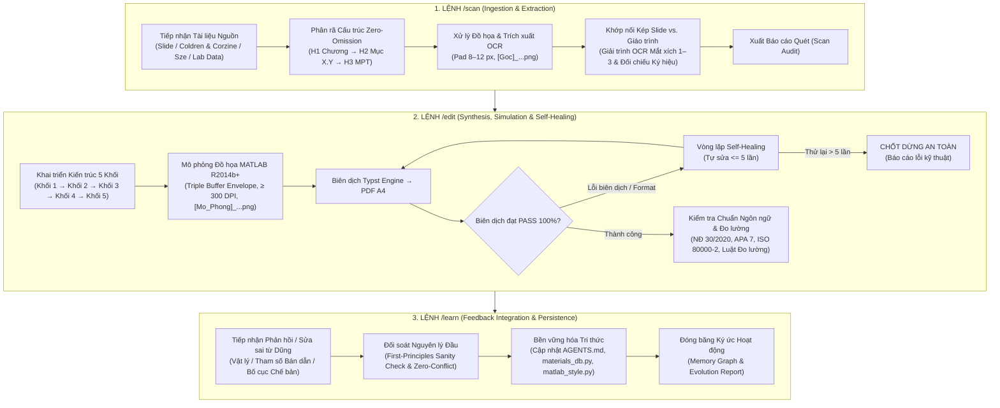

# BÁO CÁO QUY TRÌNH VẬN HÀNH HỆ THỐNG ACADEMIC RESEARCH ENGINE
## Giao thức Xử lý Chi tiết cho các Lệnh: `/scan`, `/edit`, `/learn`

> **Chủ thể:** Bùi Trung Dũng — Khoa Vật lý Kỹ thuật, Đại học Bách khoa Hà Nội (HUST).  
> **Cơ chế điều phối:** Antigravity Native Engine kiêm Cộng sự Lab biên soạn ngang hàng (*Peer-level Lab Partner*).  
> **Hệ quy chiếu tối cao:** [AGENTS.md](file:///d:/antigravity/academic-research-engine/.agents/rules/AGENTS.md) — 5 Mệnh lệnh Cốt lõi & Kiến trúc Chuyên khảo 5 Khối.

---



---

# I. LỆNH `/scan` — THU NẠP, PHÂN RÃ CẤU TRÚC & GIÁM ĐỊNH TÀI LIỆU NGUỒN

Lệnh `/scan` kích hoạt pha thẩm định và bóc tách tài liệu đầu vào (nằm trong `data/source_materials/` hoặc `data/raw_lab_data/`). Mục tiêu tối thượng của pha này là triệt tiêu hoàn toàn sự thiếu sót (*Zero-Omission*) trước khi bước vào chế bản.

### Bước 1.1: Định tuyến Nguồn & Phân loại Định dạng
1. **Kiểm tra không gian lưu trữ:**
   - Tài liệu lý thuyết: Quét các tệp PDF/Slide trong `data/source_materials/` (ví dụ: `Chuong_2_Coldren_Corzine.pdf`, giáo trình Sze, slide bài giảng HUST).
   - Dữ liệu thực nghiệm: Quét các tệp dữ liệu thô trong `data/raw_lab_data/` (đặc tuyến $I\text{–}V$, $L\text{–}I\text{–}V$, phổ phân tích quang phổ PL/EL dạng `.csv`, `.dat`, `.txt`).
2. **Xác định tọa độ học thuật:** Định vị chương, mục, phạm vi kiến thức (ví dụ: Laser bán dẫn dị thể kép, giếng lượng tử QW, điện trở vi phân $R_s$, hay dòng ngưỡng $I_{\text{th}}$).

### Bước 1.2: Bóc tách Cấu trúc Zero-Omission (Slide & Giáo trình)
1. **Trích xuất mục lục đa tầng:** Lập sơ đồ phân nhánh từ cấp độ Chương (H1) $\to$ Phân mục (H2: Mục X.Y) $\to$ Luận điểm Vi mô Độc lập (MPT — H3: Luận điểm X.Y.k).
2. **Khớp nối nguồn kép:**
   - **Slide bài giảng:** Khóa cứng hệ thống ký hiệu quy ước chính và khung xương các đề mục.
   - **Giáo trình chuyên khảo (Coldren, Sze, Yariv...):** Bồi đắp toàn bộ các giả thiết vi mô, cơ chế tương tác lượng tử và các bước dẫn xuất trung gian mà slide thường giản lược.
3. **Lập danh mục thực thể:** Liệt kê 100% công thức toán học, hằng số thực nghiệm, giả thiết biên và các thông số vật liệu bán dẫn liên quan.

### Bước 1.3: Trích xuất Đồ họa & Xử lý OCR Mắt xích 1–3
1. **Tách và chuẩn hóa hình ảnh gốc:**
   - Trích xuất toàn bộ hình vẽ, giản đồ vùng năng lượng ($E\text{–}z$, $E\text{–}k$), phân bố trường quang trong hốc cộng hưởng ra thư mục `output/figures/` với quy ước định danh:  
     `[Goc]_<MaMuc>_<TenHinh>.png`.
   - Tự động cắt viền thừa bằng script xử lý ảnh, bảo đảm khoảng đệm chuẩn: `pad = 8–12 px`.
2. **Thực thi giao thức OCR Mắt xích 1–3 (Chuẩn bị dữ liệu cho Khối 1):**
   - **Mắt xích 1 — Bản chất & Mục tiêu hình vẽ:** Giải trình mục tiêu vật lý tối thượng của hình vẽ (mô tả sự giam giữ hạt tải, sự phân bố mode quang, hay dòng tái hợp).
   - **Mắt xích 2 — Giải mã Không gian & Hệ ký hiệu gốc:** Đọc toàn bộ nhãn trục, ký hiệu vecto sóng $k$, mức Fermi giả $E_{Fc}, E_{Fv}$, bước sóng $\lambda$, chiết suất $n$.
   - **Mắt xích 3 — Cơ chế Vật lý & Hành vi Tia/Hạt:** Mô tả đường đi của photon, sự tán xạ của electron/lỗ trống, điều kiện phân cực thuận/nghịch.

### Bước 1.4: Xuất Bản Báo cáo Quét (Scan Audit Report)
Kết thúc lệnh `/scan`, hệ thống tổng hợp một bảng kiểm tra (*Audit Checklist*) gồm:
- Danh sách các mục X.Y cần xuất bản thành file PDF riêng rẽ (`1 Mục X.Y = 1 File PDF`).
- Danh sách hình ảnh `[Goc]_...png` đã sẵn sàng.
- Các nghịch lý vật lý phát hiện được giữa mô hình vĩ mô và vi mô để đưa vào Khối 1.

---

# II. LỆNH `/edit` — CHẾ BẢN CHUYÊN KHẢO 5 KHỐI, MÔ PHỎNG & SELF-HEALING

Lệnh `/edit` là trái tim của hệ thống, chịu trách nhiệm hiện thực hóa tri thức thành chuyên khảo Typst đỉnh cao, chạy mô phỏng giải tích và tự động biên dịch, sửa lỗi cho đến khi đạt `PASS 100%`.
- **Mặc định:** Thực thi Clean-Slate Recompilation toàn phần — làm lại 100% toàn bộ nội dung từ đầu và tạo lại toàn bộ hình ảnh mới hoàn toàn, xóa cache tạm và tái biên dịch PDF mới từ đầu.
- **Ngoại lệ duy nhất:** Trừ khi Bùi Trung Dũng viết rõ/chỉ định đích danh nội dung cần chỉnh sửa cục bộ, hệ thống mới tiến hành sửa đúng phạm vi được yêu cầu.

### Bước 2.1: Triển khai Cấu trúc 5 Khối Chuẩn hóa
Với mỗi Phân mục (Mục X.Y), hệ thống viết tệp nguồn `.typ` tuân thủ nghiêm ngặt 5 khối:

```
[Mục X.Y - File PDF Độc lập]
 ├── KHỐI 1: Visual Anchor & Paradox (Ảnh [Goc] + OCR Mắt xích 1–3 + Nghịch lý mở đầu)
 ├── KHỐI 2: Feynman Core & Cột trụ Cấp 3 (Hệ thức Cột trụ + Nomenclature ISO + Ẩn dụ 3 Nhịp)
 ├── KHỐI 3: Causal Flowchain (Giả thiết + Biên + Tường minh biến đổi + OCR Mắt xích 4–5)
 ├── KHỐI 4: Asymptotic Sanity Check (Khảo sát cực hạn >= 2 giới hạn + Đồ thị [Mo_Phong])
 └── KHỐI 5: CER Diagnostic Challenge (1–2 bài toán chẩn đoán R&D mở ở cuối file PDF)
```

1. **Khối 1 (Visual Anchor & Paradox):**
   - Đặt ảnh `[Goc]_...png` ngay đầu mục. Nếu không có ảnh gốc, tự động đôn đồ thị mô phỏng `[Mo_Phong]_...png` lên thay thế.
   - Trình bày toàn văn 3 mắt xích OCR đã giải mã ở pha `/scan`.
   - Nêu nghịch lý thang đo (2–4 câu): Xung đột giữa trực giác cổ điển và bản chất lượng tử.
2. **Khối 2 (Feynman Core):**
   - Khái quát luận điểm vi mô cốt lõi bằng trực giác vật lý sâu sắc.
   - Đóng khung Hệ thức Cột trụ Cấp 3 bằng viền `#0072BD` trên nền `#F0F7FF`.
   - Lập Bảng *Nomenclature* 4 cột chuẩn ISO 80000-2: `Tên đại lượng | Ký hiệu | Đơn vị SI | Ý nghĩa vi mô & Hình học 3D của toán tử`.
   - Thiết lập **Ẩn dụ Cơ học Vĩ mô Khóa Biến số 3 Nhịp** (Văn bản thuần túy, duy nhất 1 lần/MPT):
     * *Nhịp 1:* Mô hình vĩ mô cầm nắm được trong đời thực.
     * *Nhịp 2:* Ánh xạ khóa 1-1 vào từng ký hiệu trong phương trình cột trụ.
     * *Nhịp 3:* Ứng dụng thực chiến trong bài toán thiết kế linh kiện.
3. **Khối 3 (Causal Flowchain):**
   - Xây dựng chuỗi nhân quả logic chặt chẽ qua các ký hiệu `⇒` và `↳`.
   - Khảo sát kỹ miền áp dụng (*Validity Domain*) và điều kiện biên tại mặt phân cách dị thể (*heterointerface*).
   - Tường minh 100% các bước biến đổi trung gian (OCR Mắt xích 4).
   - Khẳng định Hệ thức Đích và quy ước dấu đại số (OCR Mắt xích 5), quy chiếu thẳng về Khối 2.
4. **Khối 4 (Asymptotic Sanity Check & Thực chiến):**
   - Kiểm tra cực hạn $\ge 2$ giới hạn tiệm cận: Ví dụ khi nhiệt độ $T \to 0\text{ K}$ so với $300\text{ K}$, hoặc tần số $\omega \to 0$ so với $\omega \to \infty$ để chứng minh phương trình suy biến chính xác về định luật cổ điển đã biết.
   - Phân tích tương quan giữa các thông số điều khiển linh kiện ($I_{\text{th}}, \eta_d, \lambda, R_s$).
5. **Khối 5 (CER Diagnostic Challenge):**
   - Thiết lập 1–2 ca chẩn đoán R&D mở theo cấu trúc Luận điểm – Bằng chứng – Lập luận (*Claim – Evidence – Reasoning*).
   - **Tuyệt đối không giải hộ đáp án trong file PDF** để dành không gian phản biện trực tiếp với Dũng.

### Bước 2.2: Sinh Đồ họa Giải tích MATLAB R2014b+ Chuẩn mực
1. **Thiết kế script tính toán:**
   - Sử dụng module [matlab_style.py](file:///d:/antigravity/academic-research-engine/.agents/skills/semiconductor-photonics-lab/scripts/matlab_style.py) và [materials_db.py](file:///d:/antigravity/academic-research-engine/.agents/skills/semiconductor-photonics-lab/scripts/materials_db.py).
   - Nhập đúng thông số vật liệu bán dẫn 300 K (GaAs, InP, GaN, Si, Ge) và hằng số CODATA chuẩn xác.
2. **Quy chuẩn đồ họa bắt buộc:**
   - Kích thước: `figsize=(6.5, 4.2)`, độ phân giải $\ge 300\text{ DPI}$.
   - Khung 4 cạnh màu `#1F1F1F`, vạch chia hướng vào trong (*inward ticks*) cả 4 phía.
   - Bảng 6 màu chuẩn MATLAB: `#0072BD`, `#D95319`, `#EDB120`, `#7E2F8E`, `#77AC30`, `#7F7F7F`.
   - Kiểm soát khoảng đệm **Triple Buffer Envelope**:
     $$\delta_{\text{geom}} \ge 8\%, \quad \delta_{\text{box}} \ge 6\text{ pt}, \quad \delta_{\text{spine}} \ge 5\%$$
     Tuyệt đối không để xảy ra hiện tượng chồng lấn chữ, che khuất đường cong hay dính sát khung biên.
3. **Lưu trữ & Nhúng:** Lưu ảnh tại `output/figures/[Mo_Phong]_<MaMuc>_<NoiDung>.png` và nhúng trực tiếp vào Khối 4 của tài liệu Typst.

### Bước 2.3: Vòng lặp Tự sửa lỗi (Self-Healing Loop) & Chốt Dừng An Toàn
Khi tiến hành biên dịch Typst sang PDF trong `output/pdf/`:
1. **Thực thi lệnh biên dịch:** Kiểm tra mã thoát (*exit code*) của Typst.
2. **Nếu phát sinh lỗi:**
   - Hệ thống tự đọc `stderr` / log lỗi của Typst (lỗi cú pháp, tràn lề, thiếu font, sai đường dẫn ảnh).
   - Tự động sửa mã nguồn `.typ` hoặc script `.py`.
   - Tái biên dịch và đối soát kết quả.
3. **Quy chuẩn 5 lần thử lại (Supreme Mandate 5):**
   - Vòng lặp sửa lỗi tự động được giới hạn tối đa **5 lần**.
   - Nếu sau 5 lần vẫn chưa đạt `PASS 100%`: Hệ thống **dừng an toàn ngay lập tức**, giữ nguyên hiện trạng và báo cáo chi tiết nguyên nhân kỹ thuật cho Dũng, tuyệt đối không sửa mù mờ.

### Bước 2.4: Kiểm định Xuất bản & Quy chuẩn Ngôn ngữ
Trước khi kết thúc lệnh `/edit`, tài liệu phải vượt qua bộ lọc quy chuẩn:
- **Ngôn ngữ:** Thuật ngữ song ngữ ở lần đầu xuất hiện (`thuật ngữ tiếng Việt (english term)`), các lần sau dùng tiếng Việt thường. Đồ thị MATLAB dùng `Thuật ngữ tiếng Việt + Ký hiệu + [Đơn vị SI]`.
- **Viết hoa (Nghị định 30/2020/NĐ-CP):** Sentence case cho 100% tiêu đề H1–H3, bảng biểu, chú thích hình.
- **Viết số (APA 7):** Số đếm 0–9 không kèm đơn vị viết bằng chữ; từ 10 trở lên hoặc có đơn vị viết số Ả Rập. Dấu phẩy (`,`) thập phân, dấu chấm (`.`) hàng nghìn, gạch en-dash (`–`) cho khoảng giá trị.
- **Đơn vị SI (Luật Đo lường 04/2011/QH13):** Có đúng 1 dấu cách giữa số và đơn vị (`300 K`, `10 nm`), ngoại trừ `%` và `°` viết liền.
- **Chế bản Typst:** Khổ A4, margins 40 pt / 46 pt, thân bài font serif 13 pt (leading 18 pt, căn đều hai bên), tiêu đề sans in đậm màu `#0072BD`, chân trang đánh số `Trang X / Y`, bookmarks 3 cấp.

---

# III. LỆNH `/learn` — ĐÚC KẾT TRI THỨC, TÍCH HỢP PHẢN BIỆN & TIẾN HÓA QUY TẮC

Lệnh `/learn` là cơ chế giúp AI Agent tiến hóa nhận thức, đóng băng các hiệu chỉnh của Dũng sau mỗi buổi thảo luận/phản biện, ngăn ngừa việc lặp lại sai sót và làm giàu tri thức hệ thống.

### Bước 3.1: Tiếp nhận & Phân loại Phản hồi (Feedback Parsing)
Bóc tách tín hiệu phản hồi từ Dũng thành 4 nhóm chính:
1. **Vật lý & Dẫn xuất:** Điều chỉnh mô hình tán xạ, hiệu chỉnh biến đổi toán học trung gian, bổ sung cơ chế lượng tử còn thiếu.
2. **Cơ sở Dữ liệu Bán dẫn:** Cập nhật thông số vật liệu mới (độ linh động hạt tải $\mu$, độ rộng vùng cấm $E_g(T)$, hệ số Varshni $\alpha, \beta$, chiết suất $n_r$).
3. **Thiết kế & Đồ họa:** Tinh chỉnh tỷ lệ trục đồ thị, vị trí callout, độ tương phản màu, hoặc kiểu trình bày bảng biểu.
4. **Quy tắc Vận hành & Sư phạm:** Các lưu ý đặc thù về phong cách phản biện, văn phong học thuật, hoặc cách ngắt ý.

### Bước 3.2: Giám định Nguyên lý Đầu (First-Principles Sanity Check)
Trước khi ghi nhận bất kỳ tri thức mới nào:
- Hệ thống thực hiện kiểm định chéo: Kiến thức mới có vi phạm các định luật bảo toàn (năng lượng, điện tích, xung lượng) hay không?
- Có xung đột với 5 Mệnh lệnh Cốt lõi Tối thượng trong [AGENTS.md](file:///d:/antigravity/academic-research-engine/.agents/rules/AGENTS.md) hay không?
- Nếu phát hiện mâu thuẫn: Đưa ra thông báo đối trọng (*Peer-level Critique*) trước khi đồng ý cập nhật.

### Bước 3.3: Bền vững hóa Tri thức vào Workspace
Hệ thống tiến hành lưu trữ tri thức vào đúng vị trí kiến trúc:
1. **Cập nhật Quy tắc Toàn cục:** Ghi nhận quy định mới vào file [AGENTS.md](file:///d:/antigravity/academic-research-engine/.agents/rules/AGENTS.md) nếu đó là quy chuẩn áp dụng vĩnh viễn cho mọi tài liệu.
2. **Cập nhật Database Vật liệu:** Bổ sung trực tiếp hàm giải tích hoặc hằng số mới vào [materials_db.py](file:///d:/antigravity/academic-research-engine/.agents/skills/semiconductor-photonics-lab/scripts/materials_db.py).
3. **Cập nhật Engine Đồ họa:** Cải tiến các hàm bổ trợ vẽ trong [matlab_style.py](file:///d:/antigravity/academic-research-engine/.agents/skills/semiconductor-photonics-lab/scripts/matlab_style.py).
4. **Đồng bộ Ký ức Thực thể:** Sử dụng công cụ Memory/Graph để lưu các kinh nghiệm đo đạc lab thực tế và các lỗi đã được sửa thành các nút quan sát (*observations*).

### Bước 3.4: Xuất Bản Báo cáo Tiến hóa (Evolution Audit Report)
Hệ thống báo cáo vắn tắt cho Dũng:
- *Sai sót/Điểm mù cũ:* Đã nhận diện và nguyên nhân gốc rễ.
- *Hành động khắc phục:* Tệp tin và dòng mã đã được cập nhật.
- *Cam kết vận hành:* Tác động trực tiếp lên các lần gọi `/scan` và `/edit` trong tương lai.

---

# IV. BẢNG TỔNG HỢP SO SÁNH BA LỆNH TRỌNG TÂM

| Tiêu chí | Lệnh `/scan` | Lệnh `/edit` | Lệnh `/learn` |
| :--- | :--- | :--- | :--- |
| **Mục tiêu cốt lõi** | Thu nạp, bóc tách cấu trúc & OCR hình ảnh gốc | Khởi tạo/chỉnh sửa chuyên khảo 5 khối, mô phỏng & tự sửa lỗi | Đóng băng phản hồi, cập nhật quy tắc & làm giàu database |
| **Đầu vào chính** | File PDF giáo trình, Slide bài giảng, file data Lab | Đề cương mục X.Y, yêu cầu chỉnh sửa, dữ liệu đã quét | Ý kiến phản biện của Dũng, lỗi kỹ thuật đã được làm sáng tỏ |
| **Đầu ra chính** | Thư mục ảnh `[Goc]`, bảng OCR Mắt xích 1–3, Audit checklist | File nguồn `.typ`, ảnh `[Mo_Phong]`, file `.pdf` hoàn chỉnh | File quy tắc `AGENTS.md`, script cập nhật (`materials_db.py`) |
| **Công cụ tương tác** | PDF parser, Image cropper, OCR analyzer | Typst CLI, Python/Matplotlib, PowerShell compiler | Memory tool, Text editor, Config updater |
| **Cơ chế an toàn** | Kiểm tra toàn vẹn file, đối chiếu kép Slide vs. Sách | Vòng lặp Self-Healing tối đa 5 lần; Chốt dừng an toàn | Giám định Nguyên lý đầu, chống xung đột 5 Mệnh lệnh |
